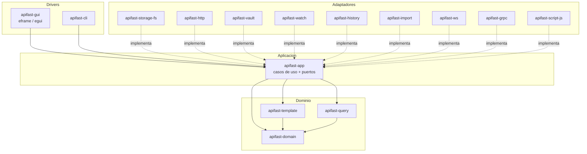
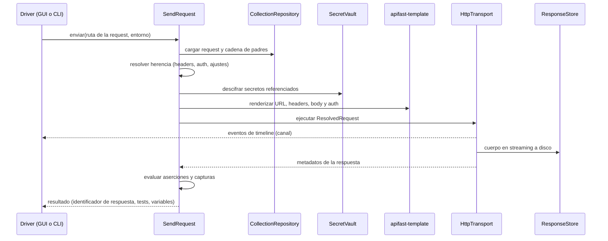

# 3. Arquitectura

apifast usa arquitectura hexagonal (puertos y adaptadores) sobre un workspace de Cargo. El dominio no conoce la red, el disco ni la interfaz. Los casos de uso dependen de traits (puertos). Los adaptadores implementan esos traits. La GUI y la CLI son dos formas de conducir la misma aplicación.

## Vista general



## Crates

| Crate | Capa | Responsabilidad | Dependencias permitidas |
|---|---|---|---|
| `apifast-domain` | Dominio | Entidades, value objects, reglas de herencia, aserciones | Solo `std` y utilidades puras |
| `apifast-template` | Dominio | Parser y renderer de plantillas | `apifast-domain` |
| `apifast-query` | Dominio | JSONPath (RFC 9535) y XPath 1.0 sobre cuerpos de respuesta | `apifast-domain`, roxmltree, regex |
| `apifast-app` | Aplicación | Casos de uso y definición de puertos | Dominio, `async-trait`/futures |
| `apifast-storage-fs` | Adaptador | Lectura y escritura YAML, escritura atómica | Aplicación, serde, oneyaml |
| `apifast-http` | Adaptador | Transporte HTTP, TLS, proxy, cookies, autenticación | Aplicación, reqwest, rustls |
| `apifast-vault` | Adaptador | Cifrado, claves, keyring | Aplicación, chacha20poly1305, keyring |
| `apifast-watch` | Adaptador | Observación del sistema de archivos | Aplicación, notify |
| `apifast-history` | Adaptador | Historial y cuerpos de respuesta en disco | Aplicación |
| `apifast-import` | Adaptador | Importadores y exportadores. Hoy, cURL (`parse_curl` y `to_curl`) Postman (`import_postman`, `import_postman_environment`) OpenAPI 3 (`import_openapi`, sobre un valor JSON: el YAML lo convierte `yaml_to_json` de `apifast-storage-fs`, el único que usa oneyaml) , Bruno `.bru` (`import_bruno`, que lee la carpeta) e Insomnia v4 y v5 (`import_insomnia`, también sobre JSON): cURL (sobre una `RenderedRequest` de `render_for_copy`, el caso de uso que renderiza sin enviar); la interfaz lo usa directamente, sin puerto, porque es puro | Aplicación, serde |
| `apifast-ws` | Adaptador | WebSocket: los frames, sobre el handshake de `apifast-http` | Aplicación, `apifast-http`, tokio-tungstenite |
| `apifast-grpc` | Adaptador | gRPC y reflection | Aplicación, tonic, prost-reflect |
| `apifast-script-js` | Adaptador | Motor JavaScript | Aplicación, rquickjs |
| `apifast-gui` | Driver | Interfaz egui y composición | Aplicación y todos los adaptadores |
| `apifast-cli` | Driver | Línea de comandos y composición | Aplicación y los adaptadores que use |

### Reglas de dependencia

1. `apifast-domain` no depende de ningún otro crate del workspace, ni de tokio, serde, reqwest o egui. `apifast-template` y `apifast-query` solo dependen de él, y siguen siendo puros: sin E/S.
2. `apifast-app` solo depende del dominio. Nunca de un adaptador.
3. Un adaptador nunca depende de otro adaptador. La única excepción es `apifast-ws`, que usa `apifast-http` para el handshake: así una conexión WebSocket tiene el mismo proxy, TLS, certificados y DNS que una request, sin duplicarlos.
4. Solo los drivers (`apifast-gui`, `apifast-cli`) conocen los tipos concretos y los conectan (raíz de composición).
5. Los DTO de serialización viven en el adaptador, no en el dominio.

Estas reglas se comprueban en CI con un test que inspecciona `cargo metadata` (ver [calidad](11-calidad-y-clean-code.md)).

## Dominio

Tipos principales de `apifast-domain`:

| Tipo | Descripción |
|---|---|
| `Collection` | Raíz: identificador estable, nombre, valores por defecto de request, configuración |
| `Folder` | Nodo intermedio con sus propios headers, auth, variables y ajustes |
| `Request` | Enum: `Http`. GraphQL y WebSocket son una `HttpRequest` con su body (`GraphQl`, `WebSocket`), y `HttpRequest::kind()` dice cuál ([ADR 0011](adr/0011-websocket-como-body.md)); gRPC se decide en F8 |
| `Environment` | Lista de variables, `extends`, color |
| `Variable` | Nombre, valor, tipo (`String`, `Number`, `Bool`, `Object`), habilitada, clase de secreto |
| `Auth` | `Setting<AuthScheme>`: `Inherit` o un esquema (`None`, `Basic`, `Bearer`, `ApiKey`, `Digest`, `Ntlm`, `AwsV4`, y en F5 `OAuth2`). Los que dependen de la request que sale o de la respuesta se aplican en el transporte (`TransportAuth`). Una request resuelta nunca tiene auth heredada |
| `Body` | Enum: `None`, `Json`, `Text`, `Xml`, `FormUrlEncoded`, `Multipart`, `File`, `GraphQl`, `WebSocket` (los mensajes de la conexión) |
| `Assertion` | Expresión, operador, valor esperado |
| `Capture` | Selector sobre la respuesta, variable de destino y ámbito |
| `Setting<T>` | Valor heredable: `Inherit` o `Set(T)` |
| `Resolved<T>` | Valor resuelto más su procedencia (`Origin`: por defecto, global, colección, entorno, carpeta, request, runtime o pregunta) |
| `Secret` | Envoltorio que no implementa `Debug` ni `Display` con el valor y se borra al liberarse |

La resolución de herencia es una función pura: recibe la cadena `colección → carpetas → request` y devuelve una `ResolvedRequest`. Ese tipo es el único que acepta el transporte, de modo que enviar una request sin resolver herencia no compila (patrón tomado de `ResolvedHttpRequest` en Yaak).

Reglas de herencia:

- **Headers:** se acumulan de la colección a la request. Un header sustituye a los de niveles anteriores con el mismo nombre, **sin distinguir mayúsculas** (Bruno solo lo hace con `content-type`, pero en HTTP los nombres de header no distinguen mayúsculas). Dentro de un mismo nivel se conservan los repetidos.
- **Auth y cada ajuste:** por separado, gana el nivel más cercano que lo defina; si nadie lo hace, el valor por defecto (sin auth y los ajustes de [motor de red](07-motor-de-red.md)). Una colección con auth `inherit` equivale a sin auth.
- **Parámetros y body:** son propios de la request.
- **Variables:** precedencia de [variables y plantillas](05-variables-y-plantillas.md); cada variable resuelta indica qué ámbitos sobrescribe.

## Puertos

Definidos como traits en `apifast-app`:

| Puerto | Función | Adaptador |
|---|---|---|
| `CollectionRepository` | Cargar, guardar, mover y borrar colecciones, carpetas y requests | `apifast-storage-fs` |
| `EnvironmentRepository` | Cargar y guardar entornos y `.env` | `apifast-storage-fs` |
| `SecretVault` | Cifrar, descifrar y almacenar secretos | `apifast-vault` |
| `KeyStore` | Guardar y recuperar la clave maestra | `apifast-vault` (keyring o archivo `0600`) |
| `HttpTransport` | Ejecutar una `ResolvedRequest` y emitir eventos | `apifast-http` |
| `WsTransport` | Abrir una conexión WebSocket desde una `RenderedRequest`, enviar lo que da un `WsHandler` y avisarle de lo que pasa | `apifast-ws` |
| `ResponseStore` | Escribir y leer cuerpos de respuesta por ventanas | `apifast-history` |
| `HistoryStore` | Registrar y consultar ejecuciones | `apifast-history` |
| `CookieStore` | Persistir el tarro de cookies de una colección, que comparten el transporte (`Cookies`) y el editor | `apifast-vault` (sellado con la clave maestra, como los tokens) |
| `SessionStore` | Guardar las pestañas abiertas y sus borradores sin guardar | `apifast-storage-fs` |
| `WorkspaceRepository` | Leer y editar `workspace.yml`: nombre y colecciones del workspace | `apifast-storage-fs` |
| `FsWatcher` | Notificar cambios externos en la colección, agrupados en lotes de rutas relativas. No implementa un puerto: el driver lo arranca al abrir la colección y reconcilia cada lote (`ApplyExternalChange`) | `apifast-watch` |
| `ScriptEngine` | Ejecutar scripts de usuario | `apifast-script-js` |
| `Clock` | Hora actual y medición de tiempos | Sistema, o falso en tests |
| `Pause` | Esperar entre las requests de una ejecución del runner | tokio, o una que no espera en tests |
| `Prompter` | Pedir un valor al usuario (`{{?Texto}}`) | GUI o terminal |

Cada puerto tiene además una implementación en memoria para tests, en `apifast_app::memory`.

El estado personal de cada workspace (colecciones desplegadas, pestañas) y la lista de workspaces conocidos no son puertos: la GUI usa directamente `FsWorkspaceState` y `FsKnownWorkspaces`, como hace con los atajos y los ajustes.

La interfaz trabaja con un workspace activo y varias colecciones a la vez ([ADR 0009](adr/0009-workspaces-y-varias-colecciones.md)). El núcleo de la GUI guarda los puertos de cada colección cargada (repositorio, transporte, historial, sesión, bóveda y watcher) por su carpeta raíz, y las pestañas y los comandos indican a qué colección pertenecen. Los casos de uso no cambian: siempre trabajan sobre una colección.

Los repositorios son síncronos: leen archivos pequeños y el driver los ejecuta fuera del hilo de la interfaz. `HttpTransport` es asíncrono, con `async fn` nativo en traits y futures `Send`, así que `apifast-app` no depende de tokio.

### Cadena de tipos del envío

```
archivo → ResolvedRequest → RenderedRequest → HttpTransport
          (herencia)        (plantillas y auth)
```

Cada tipo solo se construye a partir del anterior (`resolve` en el dominio, `render_request` en la aplicación), con campos privados y un doctest `compile_fail` que lo comprueba. Al renderizar:

- La query sale de la URL, como en Bruno: la lista `params` de tipo query solo la refleja para la interfaz. Los path params sustituyen los segmentos `:nombre` de la ruta.
- Con `encodeUrl` activado, la URL se codifica como en Bruno ([motor de red](07-motor-de-red.md#codificación-de-la-url-encodeurl)), antes de que la auth añada su parámetro a la query.
- Se añade un `Content-Type` según el body si ningún header lo define.
- La auth se convierte en headers o en un parámetro de query y sustituye el `Authorization` (o el header de la API key) de la request.
- Un esquema de auth o un tipo de body todavía no implementado es un error, nunca un envío sin él.

## Casos de uso

| Caso de uso | Resumen |
|---|---|
| `OpenCollection` | Carga metadatos, registra el watcher y devuelve el árbol |
| `LoadRequest` | Carga el contenido completo de una request |
| `SaveRequest` | Valida y escribe de forma atómica |
| `ResolveVariables` | Construye el mapa de variables con procedencia |
| `SendRequest` | Resuelve herencia, renderiza, autentica, envía, valida y captura |
| `RunCollection` | Ejecuta varias requests en orden y agrega resultados |
| `UnlockVault` | Obtiene la clave maestra y la clave de la colección |
| `SetSecret` | Cifra y guarda un secreto compartido o local |
| `ImportCollection` | Genera un plan de importación y lo aplica: `plan_import` (qué carpetas, requests y entornos se crearían, con su ruta, y los avisos) y `apply_import` (los escribe con los puertos de colección y entornos, en el mismo orden). Cada importador traduce su formato a `ImportedCollection`, con una clave estable por request |
| `ExportCollection` | `collection_contents` lee la colección entera (carpetas y requests en el orden del árbol, y sus entornos) con la misma forma que producen los importadores, y los exportadores de `apifast-import` la escriben: `export_postman`, `export_postman_environment` y `write_postman`, que deja los archivos. Lo que no se puede leer o no tiene lugar en el destino se lista |
| `ReimportCollection` | Importa otra vez en una colección importada ([ADR 0010](adr/0010-reimportacion.md)): `plan_reimport` compara cada request como vino, como está y como la trae la fuente, y `apply_reimport` aplica lo elegido. El registro de la última importación se lee y escribe con el puerto `ImportRecords` (`.apifast/import.yml` en `apifast-storage-fs`) |
| `ApplyExternalChange` | Reconcilia un cambio detectado por el watcher |

### Flujo de `SendRequest`



Puntos importantes:

- El driver recibe un **identificador de respuesta**, no el cuerpo. El visor pide ventanas del cuerpo al `ResponseStore`.
- Los eventos del timeline llegan por un canal, así la interfaz muestra el progreso sin bloquearse.
- La cancelación se propaga con un token que el transporte revisa entre lecturas.

## Concurrencia

- Un runtime de tokio con pocos hilos de trabajo, creado por el driver.
- La interfaz corre en el hilo principal y nunca espera operaciones de entrada/salida.
- Los casos de uso se lanzan como tareas; devuelven resultados por canales y piden un repintado a egui al terminar.
- El estado compartido entre la interfaz y el núcleo se limita a instantáneas inmutables (`Arc`) que el núcleo reemplaza.

## Manejo de errores

- Cada crate define su enum de error con `thiserror`.
- `apifast-app` traduce los errores de adaptadores a errores de aplicación con contexto útil para el usuario.
- Los drivers convierten esos errores en mensajes; solo ellos usan `anyhow`.
- Ningún mensaje de error incluye el valor de un secreto.

## Estructura de directorios prevista

```
apifast/
├── Cargo.toml              # workspace
├── crates/
│   ├── apifast-domain/
│   ├── apifast-template/
│   ├── apifast-query/
│   ├── apifast-app/
│   ├── apifast-storage-fs/
│   ├── apifast-http/
│   ├── apifast-vault/
│   ├── apifast-watch/
│   ├── apifast-history/
│   ├── apifast-import/
│   ├── apifast-ws/
│   ├── apifast-grpc/
│   ├── apifast-script-js/
│   ├── apifast-gui/
│   ├── apifast-cli/
│   └── apifast-arch-tests/ # test de reglas de dependencia
├── docs/
└── tests/                  # colecciones de ejemplo y pruebas de extremo a extremo
```
