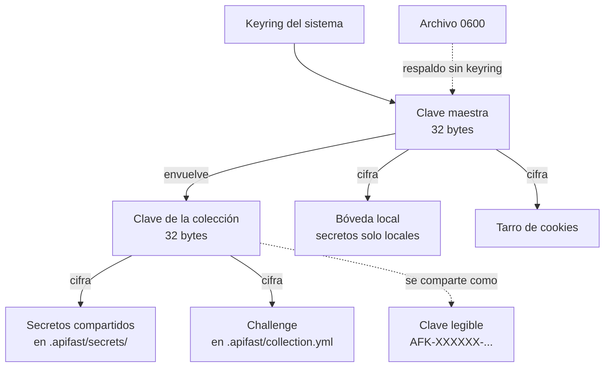

# 6. Bóveda de secretos

La bóveda protege los valores sensibles (tokens, contraseñas, claves de API). Combina dos modelos:

- **Secreto solo local** (modelo de Bruno): en el repositorio queda solo el nombre. El valor se guarda cifrado en la máquina de cada usuario. **Es el modelo por defecto** al marcar una variable como secreta.
- **Secreto compartido** (modelo de Yaak): el valor va cifrado dentro de la colección, en `.apifast/secrets/`. Se puede subir a git y lo descifra quien tenga la clave de la colección. Compartir es siempre una acción explícita.

El usuario elige el modelo por variable.

## Modelo de amenazas

| Amenaza | Cubierta | Cómo |
|---|---|---|
| Secreto subido a git en claro | Sí | Los secretos nunca se escriben en claro en la colección |
| Lectura del repositorio por un tercero | Sí | Los secretos compartidos están cifrados con una clave que no está en el repositorio |
| Copia del directorio de datos del usuario | Con keyring: sí. Sin keyring: no | Todo está cifrado con la clave maestra. Con keyring, la clave no está en el directorio; con el respaldo en archivo, sí |
| Secreto visible en logs, historial o timeline | Sí | Enmascarado en origen |
| Secreto visible en pantalla por descuido | Sí | Oculto por defecto en la interfaz |
| Manipulación de un valor cifrado | Sí | Cifrado autenticado; un cambio hace fallar el descifrado |
| Intercambio de valores cifrados entre variables | Sí | Datos asociados que atan el valor a su colección y nombre |
| Malware con los permisos del usuario y la sesión abierta | No | Puede pedir la clave al keyring igual que la aplicación |
| Volcado de memoria del proceso | Parcial | Los secretos se borran al liberarse, pero existen mientras se usan |
| Un servidor que recibe el secreto | No | Enviar el secreto es el propósito |

## Jerarquía de claves



| Clave | Tamaño | Dónde vive | Protege |
|---|---|---|---|
| Clave maestra | 32 bytes aleatorios | Keyring del sistema, o archivo `0600` si no hay keyring | Claves de colección, bóveda local, cookies |
| Clave de la colección | 32 bytes aleatorios | `keys/<collection-id>.key`, envuelta con la maestra | Secretos compartidos de esa colección |

### Clave maestra

- Se genera la primera vez que se necesita.
- Se guarda en el keyring del sistema (Secret Service en Linux, Keychain en macOS, Credential Manager en Windows).
- **Respaldo sin keyring:** la clave maestra se guarda en un archivo con permisos `0600` en el directorio de datos, igual que hace Yaak. No se pide nada al usuario.
- **Solo sin keyring.** El archivo se usa cuando el sistema no tiene keyring. Si el keyring existe pero está bloqueado o falla, es un error y se pide desbloquearlo: pasar al archivo crearía una clave nueva, y los secretos cifrados con la del keyring dejarían de abrirse. Una clave creada en el archivo sigue usándose aunque después aparezca un keyring.
- El archivo es `master.key` en el directorio de datos. Se escribe aparte con permisos `0600` y se renombra; si al leerlo tiene permisos más abiertos, se vuelven a cerrar.
- **Límite del respaldo:** protege frente a otros usuarios de la máquina, no frente a quien copie el directorio personal completo. La interfaz indica en la barra de estado cuándo la bóveda usa el archivo en lugar del keyring.
- La clave es siempre aleatoria. No existe ningún modo con clave derivable de datos de la máquina.
- Una passphrase como alternativa al archivo queda como mejora posterior a la 1.0.

### Clave de la colección

- Se genera al guardar el primer secreto compartido de una colección.
- Se guarda envuelta con la clave maestra, indexada por el **identificador estable** de la colección (`id` en `.apifast/collection.yml`), no por su ruta. Mover o renombrar la carpeta no afecta.
- El archivo `keys/<collection-id>.key` contiene un sobre `enc:v1:` con datos asociados `apifast/v1|<collection-id>|collection-key`: copiado a otra colección no se abre. Se escribe con permisos `0600`. Solo se aceptan identificadores de letras, números, `_` y `-`, para que uno dañado no apunte fuera de `keys/`.

## Formato del sobre

Todos los valores cifrados usan **XChaCha20-Poly1305**:

```
enc:v1:<base64url sin relleno de ( nonce de 24 bytes | texto cifrado | etiqueta de 16 bytes )>
```

- El nonce es aleatorio en cada cifrado. Con 24 bytes no hace falta llevar contador.
- `v1` identifica el algoritmo y el formato; un cambio futuro usará `v2` y la aplicación seguirá leyendo `v1`.
- **Datos asociados (AAD):** `apifast/v1|<collection-id>|<nombre del entorno>|<nombre de la variable>`. Un valor copiado a otra variable, otro entorno u otra colección no se descifra.
- Al renombrar un entorno, la aplicación vuelve a cifrar sus valores con el nombre nuevo, locales y compartidos. Si falta la clave de la colección, los compartidos se quedan con el nombre anterior y se avisa.
- Una variable secreta renombrada deja su valor anterior como entrada huérfana: al leer el archivo no se distingue de un borrado más una variable nueva. Su valor se vuelve a escribir y la entrada huérfana se limpia desde el editor de entornos.

Un test con un vector fijo (clave, nonce, texto y resultado conocidos) garantiza que el formato no cambie al actualizar dependencias.

## Challenge

`.apifast/collection.yml` guarda en `vault.challenge` 32 bytes aleatorios cifrados con la clave de la colección, con datos asociados `apifast/v1|<collection-id>|challenge`. Una clave es la de la colección si el *challenge* se abre con ella. Sirve para:

- Avisar de inmediato si un compañero introduce una clave equivocada.
- Saber, al clonar un repositorio, que la colección tiene secretos compartidos y hay que pedir la clave.

## Clave compartible

Para pasar la clave de la colección a otra persona se muestra en formato legible:

```
AFK-CRRP2C-K46HH3-6RSRCM-VKJEB1-CRRK8D-9PC9JK-6D1Q71-GK8RSK
```

- Prefijo `AFK`, luego la clave en base32 Crockford (sin caracteres ambiguos) en grupos de 6.
- Se comparte por un canal externo (gestor de contraseñas del equipo). apifast no la transmite.
- Al pegarla, apifast la valida contra el *challenge* y la guarda envuelta con la clave maestra local.

## Flujos

### Guardar un secreto (solo local, por defecto)

1. El usuario marca una variable como secreta y escribe su valor.
2. En el archivo del entorno se escribe el nombre con `secret: true`, sin valor.
3. El valor se guarda en `vault/<collection-id>.vault`, cifrado con la clave maestra.

El archivo es JSON, con permisos `0600`, y cada valor va en su propio sobre:

```json
{"format": 1, "secrets": [
  {"environment": "prod", "name": "token", "value": "enc:v1:..."}
]}
```

Los datos asociados de cada sobre son los de la variable (`apifast/v1|<collection-id>|<entorno>|<variable>`): un valor movido a otra entrada no se abre.

### Compartir un secreto

1. El usuario elige "compartir con el equipo" en una variable secreta.
2. Si la colección no tiene clave, se genera y se escribe el *challenge*.
3. El valor se cifra con la clave de la colección y se guarda en `.apifast/secrets/<entorno>.yml`, con los mismos datos asociados que un secreto local. Su entrada local, si la había, se borra.

Si la colección ya tiene *challenge* pero esta máquina no tiene su clave, compartir falla y se pide la clave al equipo: crear otra dejaría a los demás sin poder abrir lo nuevo. El archivo se nombra como el entorno (con los caracteres no válidos sustituidos) y guarda el nombre real en `environment`; si se queda sin secretos, se borra.

### Abrir una colección clonada

1. apifast lee `vault.challenge` de `.apifast/collection.yml`.
2. Si no hay clave local para ese identificador, pide la clave compartible.
3. Si el usuario no la tiene, la colección se abre igual: los secretos compartidos aparecen como "bloqueados" y las requests que los usen fallan al enviarse con un mensaje que lo explica.
4. Los secretos solo locales aparecen como "sin valor" hasta que el usuario los completa.

### Enviar una request

1. El resolvedor de variables pide a la bóveda (puerto `SecretStore`) los secretos sin valor del entorno activo. La clave maestra se lee la primera vez que hace falta un secreto y no se crea al leer: quien no usa secretos nunca ve un aviso del keyring. Si el keyring está bloqueado, el envío falla con ese motivo y se vuelve a intentar en el siguiente.
2. Los valores se descifran a memoria protegida y se usan en el render.
3. Al terminar el envío, se borran.

### Rotar la clave de la colección

1. Se genera una clave nueva.
2. Se vuelven a cifrar todos los secretos compartidos y el *challenge*.
3. Los cambios quedan en los archivos para hacer commit; el equipo necesita la clave nueva.

La rotación no invalida los secretos antiguos del historial de git: si una clave se filtra, además hay que cambiar las credenciales reales.

### Convertir entre modelos

Un secreto solo local se puede compartir y uno compartido se puede volver solo local desde el editor de entornos. Al pasar de compartido a local, su entrada se elimina de `.apifast/secrets/`.

## Protección en memoria y en la interfaz

- El tipo `Secret` envuelve el valor, lo pone a cero al liberarse y no implementa `Debug` ni `Display` con el contenido.
- El resultado de un render que usó secretos lleva la lista de fragmentos sensibles. Timeline, historial, reporters y logs los sustituyen por `••••••`.
- En los campos de la interfaz el valor está oculto; "revelar" lo muestra unos segundos.
- Copiar un secreto al portapapeles lo limpia después de un tiempo configurable.
- La CLI nunca imprime secretos, ni siquiera en modo detallado.

## Qué se cifra además de los secretos

| Dato | Cifrado | Clave |
|---|---|---|
| Secretos compartidos | Sí | Colección |
| Secretos solo locales | Sí | Maestra |
| Cookies persistidas | Sí | Maestra |
| Tokens OAuth 2.0 en caché | Sí | Maestra |
| Cuerpos de respuesta e historial | No | Se pueden excluir por request |

Las respuestas pueden contener datos sensibles (por ejemplo, un token recién emitido). Una request se puede marcar como "no guardar respuesta", y el historial tiene límites de tamaño y antigüedad.

## CLI y CI

En un pipeline no hay keyring. La clave de la colección se pasa por variable de entorno:

```
APIFAST_COLLECTION_KEY=AFK-... apifast run ./mi-api --env produccion
```

Los secretos solo locales se pasan con `--env-var nombre=valor` o por variables de entorno del proceso.

## Puertos y adaptador

| Puerto | Operaciones |
|---|---|
| `KeyStore` | Obtener, crear y borrar la clave maestra |
| `SecretVault` | Cifrar, descifrar, guardar y leer secretos locales, exportar e importar la clave de la colección, rotar |

`apifast-vault` implementa ambos. `KeyStore` tiene tres implementaciones: keyring, archivo `0600` y memoria (tests).

## Dependencias previstas

| Crate | Uso |
|---|---|
| `chacha20poly1305` | Cifrado autenticado |
| `keyring` | Acceso al keyring del sistema |
| `zeroize`, `secrecy` | Borrado y protección en memoria |
| `rand` | Generación de claves y nonces |

Las versiones exactas se fijan en la fase F3, tras revisar avisos de seguridad con `cargo audit`.
