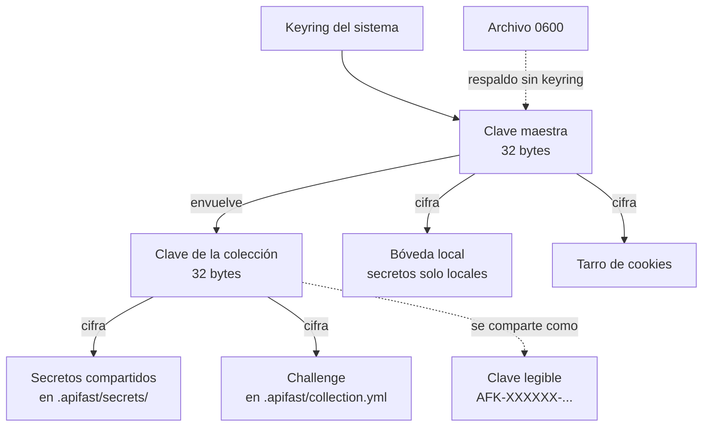

# 6. Bóveda de secretos

La bóveda protege los valores sensibles (tokens, contraseñas, claves de API). Combina dos modelos:

- **Secreto solo local** (modelo de Bruno): en el repositorio queda solo el nombre. El valor se guarda cifrado en la máquina de cada usuario. **Es el modelo por defecto** al marcar una variable como secreta.
- **Secreto compartido** (modelo de Yaak): el valor va cifrado dentro de la colección, en `.apifast/secrets/`. Se puede subir a git y lo descifra quien tenga la clave de la colección. Compartir es siempre una acción explícita.

El usuario elige el modelo por variable.

## Modelo de amenazas

| Amenaza | Cubierta | Cómo |
|---|---|---|
| Secreto subido a git en claro | Sí | Los secretos nunca se escriben en claro en la colección |
| Lectura del repositorio por un tercero | Sí | Los secretos compartidos están cifrados con una clave que no está en el repositorio |
| Copia del directorio de datos del usuario | Con keyring: sí. Sin keyring: no | Todo está cifrado con la clave maestra. Con keyring, la clave no está en el directorio; con el respaldo en archivo, sí |
| Secreto visible en logs, historial o timeline | Sí | Enmascarado en origen |
| Secreto visible en pantalla por descuido | Sí | Oculto por defecto en la interfaz |
| Manipulación de un valor cifrado | Sí | Cifrado autenticado; un cambio hace fallar el descifrado |
| Intercambio de valores cifrados entre variables | Sí | Datos asociados que atan el valor a su colección y nombre |
| Malware con los permisos del usuario y la sesión abierta | No | Puede pedir la clave al keyring igual que la aplicación |
| Volcado de memoria del proceso | Parcial | Los secretos se borran al liberarse, pero existen mientras se usan |
| Un servidor que recibe el secreto | No | Enviar el secreto es el propósito |

## Jerarquía de claves



| Clave | Tamaño | Dónde vive | Protege |
|---|---|---|---|
| Clave maestra | 32 bytes aleatorios | Keyring del sistema, o archivo `0600` si no hay keyring | Claves de colección, bóveda local, cookies |
| Clave de la colección | 32 bytes aleatorios | `keys/<collection-id>.key`, envuelta con la maestra | Secretos compartidos de esa colección |

### Clave maestra

- Se genera la primera vez que se necesita.
- Se guarda en el keyring del sistema (Secret Service en Linux, Keychain en macOS, Credential Manager en Windows).
- **Respaldo sin keyring:** la clave maestra se guarda en un archivo con permisos `0600` en el directorio de datos, igual que hace Yaak. No se pide nada al usuario.
- **Solo sin keyring.** El archivo se usa cuando el sistema no tiene keyring. Si el keyring existe pero está bloqueado o falla, es un error y se pide desbloquearlo: pasar al archivo crearía una clave nueva, y los secretos cifrados con la del keyring dejarían de abrirse. Una clave creada en el archivo sigue usándose aunque después aparezca un keyring.
- El archivo es `master.key` en el directorio de datos. Se escribe aparte con permisos `0600` y se renombra; si al leerlo tiene permisos más abiertos, se vuelven a cerrar.
- **Límite del respaldo:** protege frente a otros usuarios de la máquina, no frente a quien copie el directorio personal completo. La interfaz indica en la barra de estado cuándo la bóveda usa el archivo en lugar del keyring.
- La clave es siempre aleatoria. No existe ningún modo con clave derivable de datos de la máquina.
- Una passphrase como alternativa al archivo queda como mejora posterior a la 1.0.

### Clave de la colección

- Se genera al guardar el primer secreto compartido de una colección.
- Se guarda envuelta con la clave maestra, indexada por el **identificador estable** de la colección (`id` en `.apifast/collection.yml`), no por su ruta. Mover o renombrar la carpeta no afecta.
- El archivo `keys/<collection-id>.key` contiene un sobre `enc:v1:` con datos asociados `apifast/v1|<collection-id>|collection-key`: copiado a otra colección no se abre. Se escribe con permisos `0600`. Solo se aceptan identificadores de letras, números, `_` y `-`, para que uno dañado no apunte fuera de `keys/`.

## Formato del sobre

Todos los valores cifrados usan **XChaCha20-Poly1305**:

```
enc:v1:<base64url sin relleno de ( nonce de 24 bytes | texto cifrado | etiqueta de 16 bytes )>
```

- El nonce es aleatorio en cada cifrado. Con 24 bytes no hace falta llevar contador.
- `v1` identifica el algoritmo y el formato; un cambio futuro usará `v2` y la aplicación seguirá leyendo `v1`.
- **Datos asociados (AAD):** `apifast/v1|<collection-id>|<nombre del entorno>|<nombre de la variable>`. Un valor copiado a otra variable, otro entorno u otra colección no se descifra.
- Al renombrar un entorno, la aplicación vuelve a cifrar sus valores con el nombre nuevo, locales y compartidos. Si falta la clave de la colección, los compartidos se quedan con el nombre anterior y se avisa.
- Una variable secreta renombrada deja su valor anterior como entrada huérfana: al leer el archivo no se distingue de un borrado más una variable nueva. Su valor se vuelve a escribir y la entrada huérfana se limpia desde el editor de entornos.

Un test con un vector fijo (clave, nonce, texto y resultado conocidos) garantiza que el formato no cambie al actualizar dependencias.

## Challenge

`.apifast/collection.yml` guarda en `vault.challenge` 32 bytes aleatorios cifrados con la clave de la colección, con datos asociados `apifast/v1|<collection-id>|challenge`. Una clave es la de la colección si el *challenge* se abre con ella. Sirve para:

- Avisar de inmediato si un compañero introduce una clave equivocada.
- Saber, al clonar un repositorio, que la colección tiene secretos compartidos y hay que pedir la clave.

## Clave compartible

Para pasar la clave de la colección a otra persona se muestra en formato legible:

```
AFK-CRRP2C-K46HH3-6RSRCM-VKJEB1-CRRK8D-9PC9JK-6D1Q71-GK8RSK-0TZ4WA
```

- Prefijo `AFK`, luego 54 caracteres en base32 Crockford (sin `I`, `L`, `O` ni `U`) en 9 grupos de 6: 52 llevan los 32 bytes de la clave y los 2 últimos son de control (los 10 bits altos de un CRC-16/CCITT-FALSE de la clave). Una errata se detecta al pegarla, antes de probarla contra el *challenge*.
- Al leerla no importan las mayúsculas, los guiones ni los espacios, y `I` o `L` cuentan como `1` y `O` como `0`.
- Se comparte por un canal externo (gestor de contraseñas del equipo). apifast no la transmite.
- Al pegarla, apifast la valida contra el *challenge* y la guarda envuelta con la clave maestra local.

## Flujos

### Guardar un secreto (solo local, por defecto)

1. El usuario marca una variable como secreta y escribe su valor.
2. En el archivo del entorno se escribe el nombre con `secret: true`, sin valor.
3. El valor se guarda en `vault/<collection-id>.vault`, cifrado con la clave maestra.

El archivo es JSON, con permisos `0600`, y cada valor va en su propio sobre:

```json
{"format": 1, "secrets": [
  {"environment": "prod", "name": "token", "value": "enc:v1:..."}
]}
```

Los datos asociados de cada sobre son los de la variable (`apifast/v1|<collection-id>|<entorno>|<variable>`): un valor movido a otra entrada no se abre.

### Compartir un secreto

1. El usuario elige "compartir con el equipo" en una variable secreta.
2. Si la colección no tiene clave, se genera y se escribe el *challenge*.
3. El valor se cifra con la clave de la colección y se guarda en `.apifast/secrets/<entorno>.yml`, con los mismos datos asociados que un secreto local. Su entrada local, si la había, se borra.

Si la colección ya tiene *challenge* pero esta máquina no tiene su clave, compartir falla y se pide la clave al equipo: crear otra dejaría a los demás sin poder abrir lo nuevo. El archivo se nombra como el entorno (con los caracteres no válidos sustituidos) y guarda el nombre real en `environment`; si se queda sin secretos, se borra.

### Abrir una colección clonada

1. apifast lee `vault.challenge` de `.apifast/collection.yml`.
2. Si no hay clave local para ese identificador, pide la clave compartible.
3. Si el usuario no la tiene, la colección se abre igual: los secretos compartidos aparecen como "bloqueados" y las requests que los usen fallan al enviarse con un mensaje que lo explica.
4. Los secretos solo locales aparecen como "sin valor" hasta que el usuario los completa.

### Enviar una request

1. El resolvedor de variables pide a la bóveda (puerto `SecretStore`) los secretos sin valor del entorno activo. La clave maestra se lee la primera vez que hace falta un secreto y no se crea al leer: quien no usa secretos nunca ve un aviso del keyring. Si el keyring está bloqueado, el envío falla con ese motivo y se vuelve a intentar en el siguiente.
2. Los valores se descifran a memoria protegida y se usan en el render.
3. Al terminar el envío, se borran.

### Rotar la clave de la colección

1. Se abren todos los secretos compartidos con la clave actual; si alguno no se abre, no se toca nada.
2. Se genera una clave nueva y se guarda como la de la colección; la anterior se conserva en `keys/<collection-id>.previous.key`.
3. Se vuelven a cifrar todos los secretos compartidos y el *challenge* con la nueva.
4. Se borra la clave anterior y se muestra la nueva en formato compartible.
5. Los cambios quedan en los archivos para hacer commit; el equipo necesita la clave nueva.

Si la rotación se corta entre los pasos 2 y 4, cada valor se abre con la clave nueva o, si no, con la anterior: no se pierde nada, y volver a rotar la termina.

La rotación no invalida los secretos antiguos del historial de git: si una clave se filtra, además hay que cambiar las credenciales reales.

### Convertir entre modelos

Un secreto solo local se puede compartir y uno compartido se puede volver solo local desde el editor de entornos. Al pasar de compartido a local, su entrada se elimina de `.apifast/secrets/`.

## Protección en memoria y en la interfaz

- El tipo `Secret` envuelve el valor, lo pone a cero al liberarse y no implementa `Debug` ni `Display` con el contenido.
- El resultado de un render que usó secretos lleva la lista de fragmentos sensibles: el valor de cada secreto tal como quedó en el texto, ya renderizado si se compone de otras variables. Timeline, historial, reporters y logs los sustituyen por `••••••`, también codificado para URL: cada byte tal cual o como `%XX` (en mayúsculas o minúsculas), en cualquier mezcla, porque cada codificador deja sin codificar caracteres distintos (`encodeURIComponent` deja `!~*'()`, y el parser de URL codifica después `'` en la query).
- En el historial, una request con secretos guarda sus URLs enmascaradas y, además, con los valores de la query ocultos (`[hidden]`).
- La request renderizada se imprime con los secretos enmascarados, así que no llega en claro a un log aunque se imprima entera.
- Límite: mientras se renderiza y se envía, el valor existe en memoria como texto normal (en la URL, los headers y el body que se envían). `Secret` se borra al liberarse, pero esas copias no.
- En los campos de la interfaz el valor está oculto; "revelar" lo muestra unos segundos.
- Copiar un secreto al portapapeles lo limpia después de un tiempo configurable.
- La CLI nunca imprime secretos, ni siquiera en modo detallado.

## Cuándo se pide la clave de la colección

- **Nunca a quien la crea:** se genera al compartir el primer secreto y queda guardada en esta máquina, envuelta con la clave maestra.
- **Una sola vez por máquina:** quien la pega (en la interfaz, o con `apifast vault key import`) la tiene guardada desde entonces; reiniciar la aplicación no la vuelve a pedir.
- **Solo cuando hace falta:** el aviso para pegarla aparece al abrir una request de una colección que comparte secretos y cuya clave falta en esta máquina. Con varias colecciones abiertas, cada una tiene la suya.
- **Si no se recuerda para pasarla al equipo:** "Collection key" (menú de la raíz de la colección en el árbol, o la paleta) la muestra y la copia; `apifast vault key show` la imprime.
- **Cambiarla** es rotarla: se genera otra clave aleatoria, se vuelven a cifrar los secretos compartidos y hay que pasar la nueva al equipo.

## Identificador al guardar el primer secreto

Los secretos se indexan por el identificador estable de la colección. Una colección sin él (por ejemplo, una de Bruno recién abierta) lo recibe al guardar su primer secreto o al pegar una clave. En ese momento, lo que apifast guardaba de ella bajo el hash de su ruta (sesión, historial y cuerpos de respuesta) pasa a guardarse bajo el identificador, para no perderlo.

## Qué se cifra además de los secretos

| Dato | Cifrado | Clave |
|---|---|---|
| Secretos compartidos | Sí | Colección |
| Secretos solo locales | Sí | Maestra |
| Cookies persistidas | Sí | Maestra |
| Tokens OAuth 2.0 en caché | Sí | Maestra |
| Cuerpos de respuesta e historial | No | Se pueden excluir por request |

**Tokens OAuth 2.0** (`apifast-vault/src/tokens.rs`): un archivo por colección, `oauth2/<collection-id>.tokens` (o con el hash de la ruta si la colección no tiene id; se mueve con lo demás cuando lo recibe), en modo `0600` y escrito de forma atómica. Cada token (acceso, refresco, `id_token`, caducidad y scope) va en su propio sobre sellado con la clave maestra, con la clave de la caché como datos asociados: copiado a otra entrada, no abre. Un token que no abre (por ejemplo, tras cambiar la clave maestra) cuenta como ausente y se pide otro. Los tokens no necesitan id de colección, así que funcionan en cualquier colección. La CLI no los guarda en disco: un `send` o un `run` obtiene los suyos en memoria, como Bruno.

**Cookies** (`apifast-vault/src/cookies.rs`, `FsCookieStore`): un archivo por colección, `cookies/<collection-id>.jar` (o con el hash de la ruta, que se mueve con lo demás cuando la colección recibe id), en modo `0600` y escrito de forma atómica. El tarro entero va en un solo sobre sellado con la clave maestra. Un tarro que no abre (otra clave maestra) cuenta como vacío: los servidores vuelven a fijar sus cookies. La CLI no lo guarda en disco.

**Valores de los ajustes** (`apifast-vault/src/sealed.rs`, `SealedValues`): la contraseña del proxy de la aplicación va en `settings.sealed`, en el directorio de datos, con el mismo formato de un sobre por valor atado a su nombre. Los tokens OAuth 2.0 usan el mismo mecanismo.

Las respuestas pueden contener datos sensibles (por ejemplo, un token recién emitido). Una request se puede marcar como "no guardar respuesta", y el historial tiene límites de tamaño y antigüedad.

## CLI y CI

Los valores y las claves se leen de la entrada estándar, nunca de los argumentos, que quedarían en el historial de la shell y en la lista de procesos:

```
printf %s "$TOKEN" | apifast vault set produccion token            # solo en esta máquina
printf %s "$TOKEN" | apifast vault set produccion token --shared   # para el equipo, por git
apifast vault status                       # cada variable secreta y dónde está su valor
apifast vault key show                     # la clave de la colección, para pasarla
apifast vault key import < clave.txt       # la clave que dio el equipo
apifast vault key rotate                   # una clave nueva; la imprime
```

`vault set` solo acepta variables marcadas `secret: true` en el entorno. Si la colección no tiene identificador, lo recibe, igual que en la interfaz.

En un pipeline no hay keyring. La clave de la colección se pasa por variable de entorno; se usa solo en esa ejecución, comprobada contra el *challenge*, y no se guarda:

```
APIFAST_COLLECTION_KEY=AFK-... apifast send users/get.yml --env produccion
```

`APIFAST_NO_KEYRING=1` hace que la clave maestra vaya al archivo `0600` en lugar del keyring (también lo usan las pruebas, para no tocar el keyring de quien las ejecuta). Un secreto solo local se puede dar en CI con `--var nombre=valor`, que tiene prioridad sobre todos los ámbitos.

## Puertos y adaptador

| Pieza | Dónde | Qué hace |
|---|---|---|
| `SecretStore` | Puerto en `apifast-app` | El envío pide el valor de un secreto |
| `SharedSecretFiles` | Puerto en `apifast-app`, implementado por `FsCollection` | Los archivos de `.apifast/secrets/` y el *challenge* |
| `VaultSecrets` | `apifast-vault` | Implementa `SecretStore`: secretos locales y compartidos, clave de la colección, huérfanas, rotación |
| `KeyBackend` | `apifast-vault` | Dónde vive la clave maestra: `SystemKeyring` (que se puede apagar) o `KeyFile` (`0600`); las pruebas usan uno falso |

## Dependencias previstas

| Crate | Uso |
|---|---|
| `chacha20poly1305` | Cifrado autenticado |
| `keyring` | Acceso al keyring del sistema |
| `zeroize`, `secrecy` | Borrado y protección en memoria |
| `rand` | Generación de claves y nonces |

Las versiones exactas se fijan en la fase F3, tras revisar avisos de seguridad con `cargo audit`.
