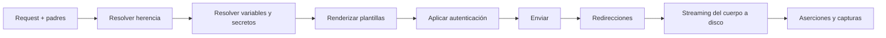

# 7. Motor de red

El motor de red ejecuta una `ResolvedRequest` y produce metadatos, eventos de timeline y un cuerpo guardado en disco. Vive detrás del puerto `HttpTransport` (y sus equivalentes para WebSocket y gRPC), así que la GUI, la CLI y el runner usan exactamente el mismo código.

## Tubería de envío

Los pasos anteriores a "Enviar" son puros y están en el dominio y la aplicación. Solo "Enviar", "Redirecciones" y "Streaming" tocan la red.

## Pila técnica

| Capa | Elección |
|---|---|
| Cliente HTTP | reqwest sobre hyper |
| TLS | rustls con el verificador de la plataforma |
| HTTP/1.1 y HTTP/2 | Sí, negociado por ALPN o forzado por ajuste |
| HTTP/3 | Fuera de la 1.0 |
| Descompresión | gzip, deflate, brotli y zstd, en streaming |
| Runtime | tokio |

Decisiones (ver [ADR 0007](adr/0007-pila-http-tls.md)):

- **Una sola pila TLS.** Para "no validar certificados" se usa un verificador permisivo de rustls, no una segunda librería.
- **Pool de conexiones activo.** Los tiempos de DNS, conexión y TLS se miden con un conector propio que emite eventos solo cuando se abre una conexión nueva. Una conexión reutilizada se indica como tal en el timeline.
- **Clientes en caché** por combinación de opciones (proxy, certificados, validación), para no reconstruirlos en cada envío.

## Ajustes por request

Todos son heredables (colección → carpeta → request) y el timeline indica de dónde salió cada valor.

| Ajuste | Por defecto |
|---|---|
| `timeout` | 30 000 ms (0 = sin límite) |
| `followRedirects` | Sí |
| `maxRedirects` | 5 |
| `encodeUrl` | Sí |
| Validar certificados | Sí |
| Versión de HTTP | Automática |
| Enviar y guardar cookies | Sí |
| Guardar respuesta en el historial | Sí |

## Redirecciones

Se gestionan manualmente para poder registrarlas:

- 301, 302 y 303 pasan a `GET` y descartan el body; 307 y 308 conservan método y body.
- Los headers sensibles (`Authorization`, `Cookie`) se eliminan al cambiar de origen.
- Cada salto genera un evento en el timeline.

## Autenticación

Implementada de forma nativa en Rust, con un enum tipado por esquema.

| Tipo | Fase | Notas |
|---|---|---|
| Basic, Bearer, API key | F1 | API key en header o en query |
| Heredada (`inherit`) y ninguna (`none`) | F1 | Toma la del padre más cercano |
| Digest | F5 | Requiere un intercambio previo |
| OAuth 2.0 | F5 | Authorization code con PKCE, client credentials, password; refresco automático |
| AWS SigV4 | F5 | Firma del request canónico |
| NTLM | F5 | Intercambio en tres pasos |

Para OAuth 2.0 con authorization code se abre el navegador del sistema y se levanta un servidor local temporal para recibir el *callback*. Los tokens se guardan cifrados con la clave maestra.

## Proxy

- Modos: desactivado, sistema, manual.
- Manual: HTTP, HTTPS y SOCKS5, con credenciales y lista de exclusiones.
- Configurable de forma global y por colección.
- La decisión tomada (qué proxy y por qué) se registra en el timeline.

## TLS y certificados

- Autoridades certificadoras adicionales (archivo PEM), global o por colección.
- Certificados cliente por host y puerto, con comodines: PEM (certificado + clave) o PKCS#12 con contraseña.
- Las contraseñas de certificados se guardan como secretos.
- Opción de desactivar la validación, por request o por colección, siempre visible en la interfaz como advertencia.

## DNS

Sobrescrituras por nombre de host (equivalente a `/etc/hosts` por colección) y registro del resultado en el timeline.

## Cookies

- Un tarro de cookies por colección, compartido entre sus requests.
- Persistido cifrado en el directorio de datos.
- Editor de cookies en la interfaz: ver, modificar y borrar.

## Cuerpo de la request

| Tipo | Envío |
|---|---|
| JSON, texto, XML | En memoria, tras el render |
| Form URL-encoded | Pares codificados |
| Multipart | Partes en streaming; los archivos se leen del disco al enviar |
| Archivo | Streaming desde el disco, sin cargarlo en memoria |
| GraphQL | JSON con `query` y `variables` |

## Respuesta

- El cuerpo se escribe **en streaming a un archivo** en `responses/<collection-id>/`, con un búfer de lectura fijo. La memoria no crece con el tamaño de la respuesta.
- La interfaz lee el archivo por ventanas para mostrarlo (ver [rendimiento](10-rendimiento-y-memoria.md)).
- Metadatos que se guardan: estado, versión de HTTP, headers, dirección remota, tamaño (comprimido y descomprimido) y tiempos.
- Las aserciones y capturas leen del archivo; para JSON grande se usa un límite de tamaño configurable antes de parsear.
- La cancelación corta la lectura y deja la respuesta marcada como cancelada.

## Timeline

Cada envío produce una lista de eventos tipados:

| Evento | Contenido |
|---|---|
| `Setting` | Ajuste aplicado y su procedencia |
| `Proxy` | Proxy elegido o motivo para no usarlo |
| `DnsResolved` | Direcciones, duración, si hubo sobrescritura |
| `Connected` | Dirección remota, duración, o "conexión reutilizada" |
| `TlsHandshake` | Versión, suite, certificado del servidor, duración |
| `RequestHeader` | Header enviado (secretos enmascarados) |
| `RequestBodySent` | Bytes enviados |
| `ResponseHeader` | Header recibido |
| `ResponseChunk` | Bytes recibidos |
| `Redirect` | Origen, destino, headers descartados |
| `Info` / `Error` | Mensajes del motor |

Los eventos se emiten por un canal mientras ocurre el envío y se guardan junto a la respuesta.

## Otros protocolos

### GraphQL (F7)

- Es una request HTTP con body especial: editor de `query` y de `variables`.
- Introspección del esquema bajo demanda, guardada en caché local, para autocompletar y explorar tipos.

### Server-Sent Events (F7)

- Se detecta por `content-type: text/event-stream`.
- Los eventos se parsean **en vivo** en Rust mientras llega el cuerpo y se muestran en una lista.
- El cuerpo completo se sigue guardando en disco.

### WebSocket (F7)

- Adaptador propio (`apifast-ws`) con conectar, enviar y cerrar.
- Reutiliza herencia de headers, autenticación, plantillas, proxy y TLS.
- Cada mensaje enviado o recibido se añade al historial de la sesión, guardado en disco.

### gRPC (F8)

- Adaptador `apifast-grpc` con tonic y prost-reflect.
- Descubrimiento de servicios por reflection (v1, con respaldo a v1alpha) o por archivos `.proto`.
- Los cuatro modos: unario, streaming de servidor, de cliente y bidireccional.
- Mensajes escritos en JSON y convertidos dinámicamente, sin código generado.
- **Punto abierto:** compilar `.proto` sin depender de un binario `protoc` externo. Se evalúa un parser en Rust en la fase F8.
- El adaptador se inicializa al abrir la primera request gRPC.

## Errores

Los errores de red se clasifican para dar mensajes útiles:

| Clase | Ejemplo de mensaje |
|---|---|
| DNS | No se pudo resolver `api.ejemplo.com` |
| Conexión | Conexión rechazada en `127.0.0.1:8080` |
| TLS | El certificado no es válido para este host |
| Timeout | Sin respuesta tras 30 s |
| Proxy | El proxy rechazó la autenticación |
| Protocolo | Respuesta HTTP mal formada |
| Cancelado | Cancelado por el usuario |
