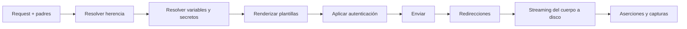

# 7. Motor de red

El motor de red ejecuta una `ResolvedRequest` y produce metadatos, eventos de timeline y un cuerpo guardado en disco. Vive detrás del puerto `HttpTransport` (y sus equivalentes para WebSocket y gRPC), así que la GUI, la CLI y el runner usan exactamente el mismo código.

## Tubería de envío

Los pasos anteriores a "Enviar" son puros y están en el dominio y la aplicación. Solo "Enviar", "Redirecciones" y "Streaming" tocan la red.

## Pila técnica

| Capa | Elección |
|---|---|
| Cliente HTTP | reqwest sobre hyper |
| TLS | rustls con el verificador de la plataforma |
| HTTP/1.1 y HTTP/2 | Sí, negociado por ALPN o forzado por ajuste |
| HTTP/3 | Fuera de la 1.0 |
| Descompresión | gzip, deflate, brotli y zstd, en streaming y a mano (ver [Respuesta](#respuesta)) |
| Runtime | tokio |

Decisiones (ver [ADR 0007](adr/0007-pila-http-tls.md)):

- **Una sola pila TLS.** Para "no validar certificados" se usa un verificador permisivo de rustls, no una segunda librería.
- **Pool de conexiones activo.** Los tiempos de DNS, conexión y TLS se miden con un conector propio que emite eventos solo cuando se abre una conexión nueva. Una conexión reutilizada se indica como tal en el timeline.
- **Clientes en caché** por combinación de opciones (proxy, certificados, validación), para no reconstruirlos en cada envío.

## Ajustes por request

Todos son heredables (colección → carpeta → request) y el timeline indica de dónde salió cada valor.

| Ajuste | Por defecto |
|---|---|
| `timeout` | 30 000 ms (0 = sin límite); en un event stream, solo hasta los headers |
| `followRedirects` | Sí |
| `maxRedirects` | 5 |
| `encodeUrl` | Sí |
| Validar certificados | Sí |
| Versión de HTTP | Automática |
| Enviar y guardar cookies | Sí (ajuste de la aplicación, no por request: ver [Cookies](#cookies)) |
| Guardar respuesta en el historial | Sí |

## Implementación en F1

`apifast-http` (`ReqwestTransport`) cubre:

- **Envío** con reqwest, rustls (proveedor ring) y el verificador de la plataforma. HTTP/1.1 y HTTP/2 por ALPN. Descompresión gzip, deflate, brotli y zstd.
- **URL sin esquema:** se añade `http://`, como en Bruno.
- **`User-Agent`:** `apifast/<versión>` si la request no define uno.
- **Timeout** de todo el intercambio (headers y cuerpo); 0 es sin límite.
- **Cancelación** que corta también la espera de la respuesta.
- **Cuerpo de la respuesta** por partes hacia el `ResponseStore`; nunca entero en memoria.
- **Bodies de archivo y partes multipart** leídos del disco en streaming, relativos a la carpeta de la colección.
- **Errores clasificados** como en la tabla de abajo. Los mensajes nunca incluyen la URL, que puede llevar secretos en la query, ni el valor de un header.

Pendiente para F5: proxy, certificados, cookies, timeline instrumentado y descompresión manual. `encodeUrl`, las cookies, el timeline de conexión y la descompresión manual llegaron en F5 (ver abajo).

Se prueba contra un servidor HTTP local escrito en los propios tests, sin red externa.

## Codificación de la URL (`encodeUrl`)

apifast codifica la URL como Bruno, para que el mismo archivo envíe los mismos bytes en las dos herramientas (`encodeUrl` de `@usebruno/common`). Se hace en `render_request` (`apifast-app/src/url_encoding.rs`), después de sustituir los path params y antes de que la auth añada su parámetro a la query, que ya va codificado y no se codifica dos veces.

- **Activado** (por defecto, también si el archivo no lo indica, como en Bruno):
  - El esquema y la autoridad (usuario, host y puerto) quedan como están. Una URL sin esquema empieza por la autoridad, así que `localhost:6000` conserva su puerto.
  - Cada segmento de la ruta se decodifica y se vuelve a codificar con `encodeURIComponent`: un segmento ya codificado no se codifica dos veces (`a%20b` sigue igual, `a b` pasa a `a%20b`). Un `%XX` mal formado, o que no da UTF-8, se codifica (`100%` pasa a `100%25`).
  - Cada nombre y valor de la query se codifica tal como está, **sin decodificar antes**: `?r=%2F` sale como `?r=%252F`. Bruno lo hace a propósito, para valores que el servidor decodifica otra vez (una URL de redirección). Los pares sin nombre se descartan.
  - `#` es un dato, no un fragmento: pasa a `%23`.
  - Un path param sin valor queda como `:id` y se codifica con la ruta: `%3Aid`.
- **Desactivado:** la URL sale como está escrita, y solo el parser de URL (WHATWG, el mismo que usa axios en Bruno) la normaliza: codifica espacios y caracteres no ASCII, resuelve `.` y `..`, y descarta el fragmento.

En los dos casos el transporte la vuelve a analizar con el crate `url`. Las requests propias de apifast (las del token de OAuth 2.0) arman su URL ya codificada.

## Redirecciones

Se gestionan manualmente para poder registrarlas:

- 301, 302 y 303 pasan a `GET` y descartan el body; 307 y 308 conservan método y body.
- Los headers sensibles (`Authorization`, `Cookie`) se eliminan al cambiar de origen.
- Cada salto genera un evento en el timeline.

## Autenticación

Implementada de forma nativa en Rust, con un enum tipado por esquema.

| Tipo | Fase | Notas |
|---|---|---|
| Basic, Bearer, API key | F1 | API key en header o en query |
| Heredada (`inherit`) y ninguna (`none`) | F1 | Toma la del padre más cercano |
| Digest | F5 (hecha) | Responde al reto del servidor, en el transporte |
| OAuth 2.0 | F5 (hecha) | Authorization code con PKCE, client credentials y password; refresco automático; tokens sellados en disco |
| AWS SigV4 | F5 (hecha) | Firma del request canónico, en el transporte |
| NTLM | F5 (hecha) | NTLMv2 en tres mensajes sobre una conexión |

### Autenticación en el transporte

Basic, Bearer y API key se resuelven al renderizar: son headers o parámetros. Las que dependen de la request tal como sale (la URL codificada, el body final) o de la respuesta del servidor llegan al transporte como `TransportAuth`, con sus campos ya renderizados, y `apifast-http` las aplica a cada request que envía. Su forma de depuración nunca muestra la clave secreta ni el token, aunque se hayan escrito tal cual en el archivo.

**AWS SigV4** (`apifast-http/src/sigv4.rs`):

- Firma con `AWS4-HMAC-SHA256` sobre la request canónica: método, ruta (codificada una vez para `s3` y dos para los demás servicios, como pide AWS), query ordenada y codificada, headers firmados (`host`, `content-type` y todo `x-amz-*`) y hash del body.
- Añade `X-Amz-Date`, `X-Amz-Security-Token` si hay token de sesión y, para `s3`, `X-Amz-Content-Sha256`.
- El hash del body es el de los bytes que se envían (texto o formulario codificado). Los bodies que se transmiten en streaming (archivo y multipart) van como `UNSIGNED-PAYLOAD`: S3 lo acepta, otros servicios pueden rechazarlo.
- Se firma cada request que sale, también tras una redirección (cambia la ruta, cambia la firma), pero solo hacia el origen que escribió el usuario: otro origen no recibe firma ni token.
- Faltar la clave, el secreto, el servicio o la región es un error antes de enviar.
- `profileName` se conserva del archivo de Bruno, pero apifast no lee los archivos de configuración de AWS.
- Comprobada con el ejemplo de la documentación de AWS (IAM `ListUsers`, firma `5d672d79…`).

**Digest** (`apifast-http/src/digest.rs`, RFC 7616 y el MD5 de RFC 2617):

- La primera request sale sin credenciales. Si la respuesta es un 401 con `WWW-Authenticate: Digest`, se descarta y la misma request vuelve a salir, body incluido, con la respuesta al reto. El timeline muestra las dos requests y el 401 entre ellas.
- Se responde una sola vez por URL: con una contraseña equivocada el resultado es el segundo 401, sin bucle. Tras una redirección al mismo origen se responde de nuevo; a otro origen no van credenciales.
- Algoritmos `MD5`, `MD5-sess`, `SHA-256` y `SHA-256-sess`, con `qop=auth` o sin `qop` (servidores RFC 2069). Un reto que solo ofrece `auth-int`, u otro algoritmo, es un error que lo dice.
- Entre varios `WWW-Authenticate` se elige el `Digest`. Se reenvían `opaque` y `realm`; `cnonce` es nuevo en cada respuesta.
- Comprobado con los ejemplos de RFC 2617 y RFC 7616 (MD5 y SHA-256) y contra un servidor local que valida la respuesta con su propio cálculo.

**NTLM** (`apifast-http/src/ntlm.rs`, NTLMv2 según [MS-NLMP]):

- La request sale con el mensaje Negotiate (`Authorization: NTLM …`). Si la respuesta es un 401 con `WWW-Authenticate: NTLM <reto>`, se lee entera y la request vuelve a salir con el mensaje Authenticate, que lleva la respuesta NTLMv2 (y la LMv2) calculada con la contraseña, el usuario y el dominio.
- NTLM autentica la **conexión**, no la request: los dos mensajes deben ir por la misma. Cada envío con NTLM usa un cliente propio, solo HTTP/1.1, con una conexión en el pool; como la respuesta intermedia se lee entera, el pool devuelve esa misma conexión. Es lo que hace Bruno con `axios-ntlm` y un agente *keep-alive*.
- El body se envía en cada mensaje, como hace Bruno; con un body grande, se envía dos veces.
- `DOMAIN\usuario` en el usuario también da el dominio si el campo de dominio está vacío.
- Con una contraseña equivocada el resultado es el 401 del servidor, sin repetir. Tras una redirección al mismo origen se negocia de nuevo; a otro origen no van credenciales.
- Se usa la hora que manda el servidor en el reto (`MsvAvTimestamp`) si la manda; si no, la del sistema. No se calculan clave de sesión, firma ni MIC: no se piden para autenticar por HTTP.
- Comprobada con el ejemplo de la especificación de Microsoft ([MS-NLMP] 4.2.4: hash NT, clave NTOWFv2, prueba NTLMv2 y respuesta LMv2) y contra un servidor local que acepta el mensaje Authenticate solo en la conexión que recibió el reto y valida la prueba con su propio cálculo.

**OAuth 2.0** (`apifast-app/src/oauth2.rs`):

- Antes de renderizar la request, el envío consigue el token y sustituye la auth OAuth 2.0 por su equivalente: un header `Authorization: <prefijo> <token>` (solo el token si el prefijo está vacío) o un parámetro de query. El token entra como variable secreta, así que se enmascara en el historial y el timeline como cualquier secreto.
- **De dónde sale el token**, en este orden: el guardado (`TokenStore`) si no ha caducado; refrescado (`grant_type=refresh_token`, en la URL de refresco o, si está vacía, la del token) si caducó, hay refresh token y `autoRefreshToken` está activo; uno nuevo si `autoFetchToken` está activo. Si no, un error que lo dice. Un token que caduca en menos de 5 s cuenta como caducado. Si el refresco falla (el refresh token también caduca), se pide uno nuevo cuando se puede.
- **Flujos:** `client_credentials` y `password` piden el token directamente. `authorization_code` llega con la fase D (necesita el navegador). `implicit` no se envía.
- **La petición de token:** `POST` con formulario a la URL del token, `Accept: application/json`, el `scope` si lo hay, y las credenciales del cliente en el body (`client_id`, `client_secret`) o como Basic, según `credentials.placement`. Los parámetros adicionales de cada petición van en el header, la query o el body que digan. Las credenciales se enmascaran en lo que se registre de esa petición.
- **La respuesta:** JSON de RFC 6749. `expires_in` da la caducidad; sin él, el token no caduca. Un error del servidor se muestra con su `error` y su `error_description`: `the token request failed (400): invalid_grant: bad password`. `tokenConfig.source: id_token` envía el `id_token` en vez del de acceso.
- **Dónde se guarda:** en la interfaz, en disco, sellado con la clave maestra ([docs/06](06-boveda-de-secretos.md#qué-se-cifra-además-de-los-secretos)): sobrevive a un reinicio. En la CLI, en memoria, durante un `send` o una ejecución de `run` (un token sirve para toda la ejecución). La clave es el id del token (`tokenConfig.id`), la URL del token y el cliente, así que varias requests con la misma auth comparten token.

**Authorization code con PKCE** (RFC 6749 4.1, RFC 7636 y RFC 8252):

- apifast arma la URL de autorización con `response_type=code`, `client_id`, `redirect_uri` (la callback URL), `state`, el `scope` y, con PKCE, `code_challenge` (S256) y `code_challenge_method`. Los parámetros adicionales de la autorización van en la query; los de header o body no tienen sentido en un navegador.
- Abre la URL en el navegador del sistema (`xdg-open`, `open` o el manejador de URLs de Windows) y escucha en el puerto de la callback URL, que debe ser `http://localhost:<puerto>/…` o `http://127.0.0.1:<puerto>/…`: una callback a otro dominio no se puede atrapar y es un error que lo explica. Escucha antes de abrir el navegador, responde al navegador con una página que dice que ya se puede cerrar e ignora otras rutas (como `favicon.ico`).
- Comprueba que la respuesta trae el mismo `state` (si no, la rechaza), y canjea el código por el token (`grant_type=authorization_code`, `code`, `redirect_uri` y, con PKCE, `code_verifier`).
- Un `state` vacío en la auth se genera al azar en cada autorización. El verificador PKCE tiene 64 caracteres.
- Si el usuario no autoriza en 5 minutos, o rechaza (`error=access_denied`), es un error con el motivo. Cancelar el envío cancela la espera.
- La interfaz siempre puede abrir el navegador, al enviar o con "Get new token". La CLI solo si se ejecuta en una terminal; en CI este flujo falla enseguida con un error que lo dice, en vez de esperar.
- Comprobado con el ejemplo de PKCE del RFC 7636, con un navegador simulado (la URL, el `state`, que el verificador corresponde al reto, el rechazo y un `state` falso) y con el servidor local de verdad, que atrapa la redirección.

## Proxy

- **Dos niveles.** La aplicación tiene un proxy (en los ajustes): el del sistema, ninguno o uno manual. Cada colección hereda ese, va sin proxy o tiene el suyo (`config.proxy` de `opencollection.yml`, [docs/04](04-formato-de-archivos.md#proxy-de-la-colección)).
- **Sistema:** las variables `HTTP_PROXY`, `HTTPS_PROXY`, `ALL_PROXY` y `NO_PROXY`, como las lee reqwest. La configuración de proxy del escritorio (GNOME, macOS, Windows) no se lee todavía.
- **Manual:** HTTP, HTTPS, SOCKS4 y SOCKS5, para todos los esquemas, con usuario y contraseña (Basic al proxy; en SOCKS5, su autenticación) y una lista de hosts que van directos (`localhost, .internal, 10.0.0.0/8`). Sin host es un error al crear el transporte.
- **Dónde se aplica:** cada colección cargada tiene su transporte con el proxy que le toca; al cambiar el proxy de la aplicación o el de la colección se reconstruye. El cliente propio de NTLM usa el mismo proxy.
- **La CLI** usa el proxy de la colección y, si la colección hereda, el del sistema: no tiene ajustes propios.
- **La contraseña** del proxy de la aplicación se guarda sellada con la clave maestra ([docs/06](06-boveda-de-secretos.md#qué-se-cifra-además-de-los-secretos)); la del proxy de una colección va en su archivo, como en Bruno.
- Pendiente: registrar en el timeline qué proxy se usó y por qué, y `{{variables}}` en los campos del proxy.
- Probado con un proxy HTTP local (línea de la request con la URL completa y `Proxy-Authorization`), las exclusiones, un proxy SOCKS5 local que reenvía la conexión, y en la interfaz guardando el proxy de una colección y enviando a través de él.

## TLS y certificados

- **Autoridades certificadoras adicionales:** archivos PEM que se confían además de las del sistema (el verificador de la plataforma conserva sus raíces). En la interfaz, un archivo en los ajustes; en la CLI, `--cacert <archivo>`, repetible. Un archivo que no se puede leer o sin certificados es un error que lo nombra; en la interfaz, las colecciones se abren igual, sin él, y el error se muestra.
- **Sin validación:** "Do not check certificates" en los ajustes, con un aviso en rojo mientras está activa, o `--insecure` en la CLI, que avisa en stderr. Afecta a todos los envíos.
- **Certificados de cliente por host:** en `config.clientCertificates` de la colección, como Bruno ([docs/04](04-formato-de-archivos.md#certificados-de-cliente)), y en "Collection settings…". El dominio admite puerto (`localhost:8443`, que solo vale para ese puerto) y comodines `*` (`*.example.com`). Las rutas son relativas a la colección. El transporte tiene un cliente por certificado activo y elige en cada salto el del host al que va, así que una redirección a otro host no presenta el certificado del primero; NTLM usa el del host de la request.
- **PEM:** certificado (con su cadena) y clave sin cifrar, en PKCS#8, RSA o EC.
- **Pendiente:** PKCS#12 (`.pfx`, `.p12`) y claves PEM cifradas. Se leen y se guardan sin perder nada, pero enviar a su host falla con un error que dice cómo convertirlos (`openssl pkcs12 -in c.pfx -out c.pem -nodes`, `openssl pkey -in key.pem -out plain.pem`). Leerlos con rustls necesita un lector de PKCS#12 (como `p12-keystore`, con unas cien dependencias), que se deja para cuando se revise el tamaño del binario.
- Probado contra un servidor TLS local que exige certificado de cliente, con una CA, un certificado de servidor y uno de cliente generados en la prueba (`rcgen`): conecta con la CA y el certificado (también con puerto y comodín), falla sin la CA, con el certificado para otro host o desactivado, y conecta sin validar con `insecure`.

## DNS

Sobrescrituras por nombre de host, como `/etc/hosts` pero solo para las requests de la colección. OpenCollection no tiene dónde guardarlas, así que van en `.apifast/collection.yml` ([docs/04](04-formato-de-archivos.md#carpeta-apifast)), que se versiona: el equipo las comparte (el host de staging, un servicio interno). Bruno no las ve.

- Cada entrada tiene un host, una IP y si está activa. El host no distingue mayúsculas y admite `*` como comodín (`*.example.com` vale para `a.b.example.com`, no para `example.com`), como los certificados de cliente.
- Varias entradas para el mismo host dan varias direcciones, en orden; se prueban como las del DNS.
- Se aplican en el resolutor del transporte (`TimedResolver`): sin consultar el DNS, y solo cambia la dirección. La request conserva su host en `Host`, en SNI y en la comprobación del certificado, así que funciona con HTTPS.
- El timeline lo dice: `DNS api.test → 10.0.0.1 (DNS override)`.
- Un host con entradas activas y ninguna IP válida es un error de DNS que lo explica (`the DNS override of `api.test` has no valid IP address`), no una búsqueda normal. La interfaz marca la dirección que no es IP mientras se escribe.
- Las usan la interfaz y la CLI. Con un proxy HTTP, el que resuelve el destino es el proxy: la sobrescritura solo afecta al nombre del proxy.
- Pendiente: `{{variables}}` en sus campos.
- Probado en el dominio (comodines, mayúsculas, IPv6), en el guardado (crear `.apifast/` y conservar el id), contra un servidor local (host conservado, evento marcado, error claro) y en la interfaz (guardar y enviar a un host que no existe).

## Cookies

Un tarro por colección, compartido por todas sus requests, como el de Bruno (tough-cookie), pero por colección en vez de uno global.

- **El tarro** (`apifast-domain/src/cookie.rs`) sigue RFC 6265:
  - `Set-Cookie` con `Expires` (el algoritmo tolerante de fechas de 5.1.1), `Max-Age` (gana sobre `Expires`; 0 o menos la borra), `Domain`, `Path`, `Secure`, `HttpOnly` y `SameSite`. Un valor sin `=` o sin nombre se ignora.
  - `Domain` debe cubrir el host que la fija, y uno sin punto (`com`) solo vale si es el propio host (`localhost`). **No hay lista de sufijos públicos**: `a.example.co.uk` puede fijar una cookie para `co.uk`. Sin `Domain`, la cookie es solo para ese host.
  - Sin `Path` (o con uno que no empieza por `/`), la ruta de la request hasta su último `/`.
  - `__Secure-` exige `Secure`; `__Host-` además exige que no haya `Domain` y que la ruta sea `/`.
  - Una cookie sustituye a la que tiene su mismo nombre, dominio y ruta, y conserva la hora de creación de esa.
- **Qué se envía:** las cookies del dominio (o, si no son solo del host, de sus subdominios), de la ruta (la de la request o una por debajo, cortando en `/`) y sin caducar. Las `Secure` solo por `https` o a la propia máquina (`localhost`, `*.localhost`, `127.0.0.1`, `::1`), como tough-cookie. Primero las de ruta más larga y, con la misma, las más antiguas. `HttpOnly` y `SameSite` se guardan y se muestran, pero no cambian lo que se envía.
- **En el transporte** (`apifast-http/src/cookies.rs`), en cada salto, también en las redirecciones y en la segunda request de Digest y NTLM: los `Set-Cookie` de cada respuesta entran en el tarro, y cada request lleva las cookies que le tocan. Si la request ya tiene un header `Cookie`, se fusionan por nombre y **gana la del tarro**, como en Bruno. Una redirección a otro origen pierde el `Cookie` escrito en la request, pero lleva las del tarro de su host.
- **Ajustes** "Send cookies" y "Store cookies", de la aplicación (como las preferencias de Bruno), activados por defecto. No son por request: OpenCollection no tiene ese ajuste.
- **Dónde se guarda:** en la interfaz, sellado con la clave maestra ([docs/06](06-boveda-de-secretos.md#qué-se-cifra-además-de-los-secretos)), y se escribe tras cada envío, ejecución u obtención de token que lo cambió, y tras cada edición. Al abrir la colección se leen sin las caducadas. Las de sesión (sin caducidad) también se guardan: sobreviven a un reinicio, como en Bruno. La CLI lleva un tarro en memoria durante un `send` o un `run`: lo que fija una request va con las siguientes de la ejecución.
- **Editor** en la interfaz ([docs/09](09-ui-ux.md#cookies)) y pestaña Cookies en la respuesta.
- El `Debug` del tarro solo dice cuántas cookies tiene: un valor puede ser una sesión.
- Probado con el tarro puro (fechas, atributos, dominios, rutas, prefijos, orden), contra un servidor local (una cookie fijada en una redirección llega al salto siguiente, no pasa a otro host, se fusiona con el header escrito y se respetan los ajustes), de extremo a extremo con `apifast run`, y en la interfaz (guardada sellada, enviada, editada y leída tras un reinicio).

## Cuerpo de la request

| Tipo | Envío |
|---|---|
| JSON, texto, XML | En memoria, tras el render |
| Form URL-encoded | Pares codificados |
| Multipart | Partes en streaming; los archivos se leen del disco al enviar, con su nombre como `filename` y el `Content-Type` de la parte o el que deduce reqwest de la extensión |
| Archivo | Streaming desde el disco, sin cargarlo en memoria, con `Content-Length`. Sin `contentType`, `application/octet-stream`, como Bruno |

Las rutas relativas se resuelven contra la carpeta de la colección y las absolutas se usan tal cual, como en Bruno. Un archivo que no se puede leer es un error antes de enviar, con su ruta. Probado con un archivo de 8 MB que llega byte a byte y con una parte fuera de la colección.
| GraphQL | JSON con `query` y `variables` |

## Respuesta

- El cuerpo se escribe **en streaming a un archivo** en `responses/<collection-id>/`, con un búfer de lectura fijo. La memoria no crece con el tamaño de la respuesta.
- La interfaz lee el archivo por ventanas para mostrarlo (ver [rendimiento](10-rendimiento-y-memoria.md)).
- Metadatos que se guardan: estado, versión de HTTP, headers, dirección remota, tamaño (comprimido y descomprimido) y tiempos.
- **Descompresión a mano** (`apifast-http/src/decode.rs`): reqwest no descomprime; apifast envía el `Accept-Encoding` que enviaba reqwest (`zstd,gzip,deflate,br`) si la request no tiene uno propio ni un `Range` (cuyos bytes serían del cuerpo comprimido), y descomprime según el `Content-Encoding`: `gzip` (y `x-gzip`), `deflate` (zlib), `br` y `zstd`. Cada trozo pasa por un decodificador que escribe en el almacén según llega, así que la memoria no crece con el cuerpo. Se guarda el cuerpo descomprimido; el tamaño en la red va en el evento `decompressed` del timeline. Los headers se guardan como llegaron (`Content-Encoding` incluido).
  - Con un `Accept-Encoding` propio también se descomprime lo que llegue, como hace Bruno.
  - `identity`, varias codificaciones encadenadas o una desconocida: el cuerpo se guarda tal cual.
  - Un cuerpo vacío (HEAD, 204, 304) no se decodifica. Uno roto o cortado es un error de protocolo: `the body is not valid gzip: …`. Un zstd cortado no se detecta: el decodificador de escritura no lo distingue.
  - Probado por codificación en trozos pequeños, con cuerpos rotos y cortados, y contra un servidor local.
- Las aserciones y capturas leen del archivo; para JSON grande se usa un límite de tamaño configurable antes de parsear.
- La cancelación corta la lectura y deja la respuesta marcada como cancelada.

## Timeline

Cada envío produce una lista de eventos tipados:

| Evento | Contenido |
|---|---|
| `Setting` | Ajuste aplicado y su procedencia |
| `Proxy` | Proxy elegido o motivo para no usarlo |
| `DnsResolved` | Direcciones, duración, si hubo sobrescritura |
| `Connected` | Dirección remota, duración, o "conexión reutilizada" |
| `TlsHandshake` | Versión, suite, certificado del servidor, duración |
| `RequestHeader` | Header enviado (secretos enmascarados) |
| `RequestBodySent` | Bytes enviados |
| `ResponseHeader` | Header recibido |
| `ResponseChunk` | Bytes recibidos |
| `Redirect` | Origen, destino, headers descartados |
| `Info` / `Error` | Mensajes del motor |

Los eventos se emiten por un canal mientras ocurre el envío y se guardan junto a la respuesta.

### Implementado

Hoy el timeline tiene `request`, `dns`, `connected` o `reused`, `tls`, `redirect`, `headers`, `body` y, si el cuerpo llegó comprimido, `decompressed` (codificación y bytes en la red), en orden y con su tiempo desde el inicio del envío. Cada salto (redirección o segunda request de Digest o NTLM) trae los suyos. Se guardan en el historial ([docs/04](04-formato-de-archivos.md#historial)).

**DNS, conexión y TLS con el pool activo** (`apifast-http/src/probe.rs`). La request se envía dentro de una sonda (`Probe::watch`, un `task_local` de tokio), y tres piezas anotan en la sonda de la tarea que las ejecuta:

- un **resolutor propio** (`TimedResolver`, el del sistema como el de reqwest), que mide cada búsqueda y anota el nombre y las direcciones;
- una **capa sobre el conector** de reqwest (`connector_layer`), que anota cuándo empieza y termina cada conexión nueva, con el proxy y TLS incluidos;
- el **almacén de sesiones TLS** de rustls (`ProbedSessions`), que anota cuándo empieza el handshake: es lo primero que rustls consulta al escribir su `ClientHello`, justo tras abrir el TCP.

Con eso: DNS es la búsqueda; la conexión va del fin del DNS (o del inicio, sin DNS, como con una IP) al inicio de TLS; TLS va de ahí al fin de la conexión. La versión de TLS sale de `TlsInfo`, y la dirección, de la respuesta. Si no hay anotaciones, la request fue por una conexión del pool y se indica como reutilizada. Una conexión que hyper termina en segundo plano, cuando la request ya tomó otra del pool, no anota nada.

Para colgar el almacén de sesiones, apifast construye la configuración de rustls en vez de reqwest (`apifast-http/src/tls.rs`): ring, el verificador de la plataforma con las CA adicionales (o uno que acepta todo, sin validación), el certificado de cliente PEM y ALPN `h2` y `http/1.1` (solo `http/1.1` para NTLM). Es la misma que construía reqwest.

Pendiente: la suite y el certificado del servidor en el evento TLS (`TlsInfo` no da la suite), el evento `Proxy`, y los de headers y bytes enviados.

Probado con un servidor que mantiene la conexión (el primer envío a `localhost` tiene DNS y conexión; el segundo, conexión reutilizada y una sola conexión en el servidor) y contra el servidor TLS local (handshake después de la conexión, con `TLSv1.3`).

## Otros protocolos

### GraphQL (F7)

- Es una request HTTP con body especial: editor de `query` y de `variables`. Se envía como `{"query": …, "variables": …}` con `Content-Type: application/json`; el formato de archivo es el de Bruno ([docs/04](04-formato-de-archivos.md#requests-graphql)).
- Introspección del esquema bajo demanda (`fetch_schema`), para autocompletar y explorar tipos. Se envía la request misma con la query de introspección estándar como body (la de GraphiQL, con referencias de tipo de siete niveles) y sin sus aserciones ni capturas, así que usa su entorno, sus headers heredados, su auth (OAuth 2.0 incluido), su proxy y sus certificados. Una respuesta que no es 2xx, que no es JSON o que no trae `__schema` da un error con el motivo; si el servidor la rechaza (introspección desactivada), el mensaje es el suyo.
- La respuesta se guarda tal cual en los datos locales de la colección (`schemas/<colección>/`, un archivo por clave), con la URL de la request tal como está escrita y el entorno como clave: cada entorno puede apuntar a otro servidor. En la siguiente sesión el esquema está sin preguntar; uno que ya no se lee como esquema cuenta como ausente. Pedirlo otra vez reemplaza el guardado; si falla, el anterior sigue.

### Server-Sent Events (F7)

- Se detecta por `content-type: text/event-stream` (sin importar mayúsculas ni parámetros como `charset`).
- Los eventos se parsean **en vivo** mientras llega el cuerpo (`apifast_domain::SseParser`), como los lee el estándar WHATWG: líneas terminadas en CRLF, LF o CR aunque caigan en trozos distintos, BOM inicial, comentarios (`:`), un espacio tras los dos puntos, `data` de varias líneas unidas con `\n`, el último `id` vigente (uno vacío lo borra) y `retry` numérico. Un evento sin `data` no se emite, ni el incompleto del final.
- El transporte avisa al escritor del cuerpo con el estado y los headers antes del primer trozo (`BodyWriter::begin`); el de la GUI lee ahí los eventos y despierta la ventana, con un solo aviso pendiente a la vez para que un stream rápido no inunde el núcleo.
- **El timeout cubre la espera hasta los headers:** un stream puede durar lo que quiera. **Cancelar un stream no es un error:** el cuerpo termina ahí y la respuesta queda con lo recibido, en el historial y con sus aserciones y capturas. En la CLI, `Ctrl+C` hace lo mismo con `apifast send`.
- El cuerpo completo se sigue guardando en disco.

### WebSocket (F7)

- **Puerto propio** (`WsTransport`), implementado por `apifast-ws`; el caso de uso es `connect_request`. La request se prepara como cualquier otra: herencia de headers y auth (OAuth 2.0 incluido), plantillas, secretos de la bóveda y `response(...)`. Una request WebSocket no se envía con `send_request`, ni una HTTP se conecta: las dos dan un error que lo dice.
- **El handshake es una request HTTP** de `apifast-http` (`ReqwestTransport::upgrade`): un `GET` HTTP/1.1 con `Upgrade: websocket`, por el mismo proxy, con la misma confianza TLS, los certificados de cliente, los overrides de DNS y el tarro de cookies, y con su timeline. `ws://` va como `http://` y `wss://` como `https://`; sin esquema, como `ws://`. El timeout cubre el handshake. Una respuesta que no es `101`, o un `Sec-WebSocket-Accept` que no corresponde a la clave enviada, es un error. Digest y NTLM, que necesitan más de una request, todavía no se pueden usar; AWS Signature v4 firma el `GET`.
- **Abierta la conexión**, tungstenite lee y escribe los frames. Los mensajes que da el driver (un `WsOutbox`) se renderizan uno a uno al salir, con las variables de la request: uno que no se renderiza (una variable que falta, salvo con `allow_unresolved`) no se envía y el log dice por qué, sin cerrar la conexión. Los pings se contestan solos.
- **Cerrar:** cancelar cierra normalmente (código 1000) y espera hasta 2 s el cierre del servidor. Si cierra el servidor, o la conexión se corta, no es un error: queda en el log con su código y su motivo.
- **El log de la conexión** es el cuerpo de su respuesta: una línea JSON por evento (`sent`, `received`, `error`, `closed`), con los milisegundos desde que se abrió y los datos binarios en hexadecimal (`apifast_domain::WsLogEntry`). Se guarda en disco como cualquier cuerpo, a medida que llega, y los secretos que se enviaron van enmascarados. La respuesta es la del handshake (`101`, con `Upgrade: websocket`, que la distingue en el historial), y su tiempo es el de toda la conexión.
- **En la GUI**, enviar una request WebSocket la conecta; cada mensaje se envía cuando el usuario lo pide, por un canal del núcleo a la conexión, y el log se lee en vivo al escribirse, como un stream SSE ([docs/09](09-ui-ux.md#requests-websocket)). Cerrar la pestaña cierra la conexión.
- **En la CLI**, `apifast send` sobre una request WebSocket se conecta, envía sus mensajes en orden y espera hasta que el servidor cierra o `Ctrl+C` ([docs/08](08-tests-y-runner.md#apifast-send)).

### gRPC (F8)

- Adaptador `apifast-grpc` con tonic y prost-reflect, detrás del puerto `GrpcTransport`. Una request gRPC es una `HttpRequest` con la llamada como body ([ADR 0012](adr/0012-grpc-como-body.md)): se prepara como cualquier otra (herencia, plantillas, secretos, OAuth 2.0), y sus headers renderizados son la metadata de la llamada, nombres en minúscula.
- **La conexión la abre `apifast-http`** (`ReqwestTransport::open`): TCP, y TLS con ALPN `h2`, con el mismo proxy, la misma confianza, los certificados de cliente y los overrides de DNS que una request; tonic habla HTTP/2 y gRPC sobre ella, sin TLS propio.
- **El proxy** se elige con las reglas de reqwest (el `Matcher` de hyper-util): las variables `HTTP_PROXY`, `HTTPS_PROXY`, `ALL_PROXY` y `NO_PROXY` con el del sistema, o el manual con sus exclusiones; `grpcs://` cuenta como `https`. Se atraviesa con `CONNECT` (a un proxy HTTP, o HTTPS en TLS con la misma confianza), SOCKS5 (con usuario y contraseña si los tiene) o SOCKS4a; el servidor se pide por nombre, así que lo resuelve el proxy. Un proxy que no deja pasar da un error que dice qué contestó (`407` pide credenciales).
- **La auth** es la de la request, en la metadata: Basic, Bearer, API key en header y OAuth 2.0. Digest, NTLM y AWS Signature, que necesitan el transporte HTTP, dan un error; una API key en la query no tiene dónde ir en una llamada.
- **La URL** es la de Bruno: `host:puerto` o `grpc://` en texto plano, `grpcs://` en TLS (también `http://` y `https://`); sin puerto, 80 o 443. Una ruta después del servidor (`grpc://h:50051/api`) se antepone a la de cada método, para servidores detrás de un prefijo.
- **Descubrir servicios** (`describe_grpc`): con un `.proto`, se compila sin preguntar al servidor ([ADR 0013](adr/0013-protox-para-proto.md)); sin él, por reflection, v1 y, si el servidor no la tiene, v1alpha. Se piden los servicios, el archivo de cada uno y los que importan; los tipos de Google que el servidor no sirve se toman de protox. El timeout de la request cubre todo, y se puede cancelar. Un servidor sin reflection da un error que pide elegir un `.proto`.
- **Llamar** (`call_grpc`): el método se busca en el `.proto` o por reflection, y los mensajes se escriben en JSON y se convierten con sus descriptores (prost-reflect), sin código generado. Los cuatro modos van igual, como un stream HTTP/2 en cada sentido: un método cuyo cliente no transmite (unario, streaming del servidor) envía el primer mensaje que encaja con su tipo; uno que transmite (del cliente, bidireccional) envía todos y luego cierra su lado. Lo que llega se lee hasta que el servidor termina la llamada con un estado.
- Cada mensaje se renderiza al salir, como en WebSocket; uno que no se renderiza, o cuyo JSON no encaja con el tipo del método, no se envía y el log dice por qué. Las respuestas se guardan en JSON con todos sus campos, también los que tienen el valor por defecto.
- **El log de la llamada** es el de una conexión WebSocket ([`WsLogEntry`](#websocket-f7)): `sent`, `received`, `error` y `closed`. Al final, `closed` por el servidor lleva el código de estado de gRPC y su nombre con el mensaje (`0 OK`, `5 NOT_FOUND: …`); cancelar la cierra desde el cliente (`1 CANCELLED`). Un estado de error no es un error de la llamada: queda en el log. La respuesta es la de HTTP/2 (`200`, `content-type: application/grpc`, que la distingue en el historial), con la metadata y los trailers como headers y el tiempo de toda la llamada.
- El timeout cubre hasta que el servidor responde; un stream largo no se corta.
- **En la GUI**, llamar envía el mensaje mostrado; mientras el cliente transmite, cada mensaje se envía cuando el usuario lo pide, por el mismo canal del núcleo que en WebSocket, y "End stream" lo cierra ([docs/09](09-ui-ux.md#requests-grpc)).
- El adaptador se inicializa al abrir la primera request gRPC.

## Errores

Los errores de red se clasifican para dar mensajes útiles:

| Clase | Ejemplo de mensaje |
|---|---|
| DNS | No se pudo resolver `api.ejemplo.com` |
| Conexión | Conexión rechazada en `127.0.0.1:8080` |
| TLS | El certificado no es válido para este host |
| Timeout | Sin respuesta tras 30 s |
| Proxy | El proxy rechazó la autenticación |
| Protocolo | Respuesta HTTP mal formada |
| Cancelado | Cancelado por el usuario |
