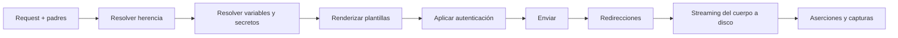

# 7. Motor de red

El motor de red ejecuta una `ResolvedRequest` y produce metadatos, eventos de timeline y un cuerpo guardado en disco. Vive detrás del puerto `HttpTransport` (y sus equivalentes para WebSocket y gRPC), así que la GUI, la CLI y el runner usan exactamente el mismo código.

## Tubería de envío

Los pasos anteriores a "Enviar" son puros y están en el dominio y la aplicación. Solo "Enviar", "Redirecciones" y "Streaming" tocan la red.

## Pila técnica

| Capa | Elección |
|---|---|
| Cliente HTTP | reqwest sobre hyper |
| TLS | rustls con el verificador de la plataforma |
| HTTP/1.1 y HTTP/2 | Sí, negociado por ALPN o forzado por ajuste |
| HTTP/3 | Fuera de la 1.0 |
| Descompresión | gzip, deflate, brotli y zstd, en streaming |
| Runtime | tokio |

Decisiones (ver [ADR 0007](adr/0007-pila-http-tls.md)):

- **Una sola pila TLS.** Para "no validar certificados" se usa un verificador permisivo de rustls, no una segunda librería.
- **Pool de conexiones activo.** Los tiempos de DNS, conexión y TLS se miden con un conector propio que emite eventos solo cuando se abre una conexión nueva. Una conexión reutilizada se indica como tal en el timeline.
- **Clientes en caché** por combinación de opciones (proxy, certificados, validación), para no reconstruirlos en cada envío.

## Ajustes por request

Todos son heredables (colección → carpeta → request) y el timeline indica de dónde salió cada valor.

| Ajuste | Por defecto |
|---|---|
| `timeout` | 30 000 ms (0 = sin límite) |
| `followRedirects` | Sí |
| `maxRedirects` | 5 |
| `encodeUrl` | Sí |
| Validar certificados | Sí |
| Versión de HTTP | Automática |
| Enviar y guardar cookies | Sí |
| Guardar respuesta en el historial | Sí |

## Implementación en F1

`apifast-http` (`ReqwestTransport`) cubre:

- **Envío** con reqwest, rustls (proveedor ring) y el verificador de la plataforma. HTTP/1.1 y HTTP/2 por ALPN. Descompresión gzip, deflate, brotli y zstd.
- **URL sin esquema:** se añade `http://`, como en Bruno.
- **`User-Agent`:** `apifast/<versión>` si la request no define uno.
- **Timeout** de todo el intercambio (headers y cuerpo); 0 es sin límite.
- **Cancelación** que corta también la espera de la respuesta.
- **Cuerpo de la respuesta** por partes hacia el `ResponseStore`; nunca entero en memoria.
- **Bodies de archivo y partes multipart** leídos del disco en streaming, relativos a la carpeta de la colección.
- **Errores clasificados** como en la tabla de abajo. Los mensajes nunca incluyen la URL, que puede llevar secretos en la query, ni el valor de un header.

Pendiente para F5: proxy, certificados, cookies, timeline instrumentado, descompresión manual y `encodeUrl: false`.

Se prueba contra un servidor HTTP local escrito en los propios tests, sin red externa.

## Redirecciones

Se gestionan manualmente para poder registrarlas:

- 301, 302 y 303 pasan a `GET` y descartan el body; 307 y 308 conservan método y body.
- Los headers sensibles (`Authorization`, `Cookie`) se eliminan al cambiar de origen.
- Cada salto genera un evento en el timeline.

## Autenticación

Implementada de forma nativa en Rust, con un enum tipado por esquema.

| Tipo | Fase | Notas |
|---|---|---|
| Basic, Bearer, API key | F1 | API key en header o en query |
| Heredada (`inherit`) y ninguna (`none`) | F1 | Toma la del padre más cercano |
| Digest | F5 (hecha) | Responde al reto del servidor, en el transporte |
| OAuth 2.0 | F5 (hecha) | Authorization code con PKCE, client credentials y password; refresco automático; tokens sellados en disco |
| AWS SigV4 | F5 (hecha) | Firma del request canónico, en el transporte |
| NTLM | F5 (hecha) | NTLMv2 en tres mensajes sobre una conexión |

### Autenticación en el transporte

Basic, Bearer y API key se resuelven al renderizar: son headers o parámetros. Las que dependen de la request tal como sale (la URL codificada, el body final) o de la respuesta del servidor llegan al transporte como `TransportAuth`, con sus campos ya renderizados, y `apifast-http` las aplica a cada request que envía. Su forma de depuración nunca muestra la clave secreta ni el token, aunque se hayan escrito tal cual en el archivo.

**AWS SigV4** (`apifast-http/src/sigv4.rs`):

- Firma con `AWS4-HMAC-SHA256` sobre la request canónica: método, ruta (codificada una vez para `s3` y dos para los demás servicios, como pide AWS), query ordenada y codificada, headers firmados (`host`, `content-type` y todo `x-amz-*`) y hash del body.
- Añade `X-Amz-Date`, `X-Amz-Security-Token` si hay token de sesión y, para `s3`, `X-Amz-Content-Sha256`.
- El hash del body es el de los bytes que se envían (texto o formulario codificado). Los bodies que se transmiten en streaming (archivo y multipart) van como `UNSIGNED-PAYLOAD`: S3 lo acepta, otros servicios pueden rechazarlo.
- Se firma cada request que sale, también tras una redirección (cambia la ruta, cambia la firma), pero solo hacia el origen que escribió el usuario: otro origen no recibe firma ni token.
- Faltar la clave, el secreto, el servicio o la región es un error antes de enviar.
- `profileName` se conserva del archivo de Bruno, pero apifast no lee los archivos de configuración de AWS.
- Comprobada con el ejemplo de la documentación de AWS (IAM `ListUsers`, firma `5d672d79…`).

**Digest** (`apifast-http/src/digest.rs`, RFC 7616 y el MD5 de RFC 2617):

- La primera request sale sin credenciales. Si la respuesta es un 401 con `WWW-Authenticate: Digest`, se descarta y la misma request vuelve a salir, body incluido, con la respuesta al reto. El timeline muestra las dos requests y el 401 entre ellas.
- Se responde una sola vez por URL: con una contraseña equivocada el resultado es el segundo 401, sin bucle. Tras una redirección al mismo origen se responde de nuevo; a otro origen no van credenciales.
- Algoritmos `MD5`, `MD5-sess`, `SHA-256` y `SHA-256-sess`, con `qop=auth` o sin `qop` (servidores RFC 2069). Un reto que solo ofrece `auth-int`, u otro algoritmo, es un error que lo dice.
- Entre varios `WWW-Authenticate` se elige el `Digest`. Se reenvían `opaque` y `realm`; `cnonce` es nuevo en cada respuesta.
- Comprobado con los ejemplos de RFC 2617 y RFC 7616 (MD5 y SHA-256) y contra un servidor local que valida la respuesta con su propio cálculo.

**NTLM** (`apifast-http/src/ntlm.rs`, NTLMv2 según [MS-NLMP]):

- La request sale con el mensaje Negotiate (`Authorization: NTLM …`). Si la respuesta es un 401 con `WWW-Authenticate: NTLM <reto>`, se lee entera y la request vuelve a salir con el mensaje Authenticate, que lleva la respuesta NTLMv2 (y la LMv2) calculada con la contraseña, el usuario y el dominio.
- NTLM autentica la **conexión**, no la request: los dos mensajes deben ir por la misma. Cada envío con NTLM usa un cliente propio, solo HTTP/1.1, con una conexión en el pool; como la respuesta intermedia se lee entera, el pool devuelve esa misma conexión. Es lo que hace Bruno con `axios-ntlm` y un agente *keep-alive*.
- El body se envía en cada mensaje, como hace Bruno; con un body grande, se envía dos veces.
- `DOMAIN\usuario` en el usuario también da el dominio si el campo de dominio está vacío.
- Con una contraseña equivocada el resultado es el 401 del servidor, sin repetir. Tras una redirección al mismo origen se negocia de nuevo; a otro origen no van credenciales.
- Se usa la hora que manda el servidor en el reto (`MsvAvTimestamp`) si la manda; si no, la del sistema. No se calculan clave de sesión, firma ni MIC: no se piden para autenticar por HTTP.
- Comprobada con el ejemplo de la especificación de Microsoft ([MS-NLMP] 4.2.4: hash NT, clave NTOWFv2, prueba NTLMv2 y respuesta LMv2) y contra un servidor local que acepta el mensaje Authenticate solo en la conexión que recibió el reto y valida la prueba con su propio cálculo.

**OAuth 2.0** (`apifast-app/src/oauth2.rs`):

- Antes de renderizar la request, el envío consigue el token y sustituye la auth OAuth 2.0 por su equivalente: un header `Authorization: <prefijo> <token>` (solo el token si el prefijo está vacío) o un parámetro de query. El token entra como variable secreta, así que se enmascara en el historial y el timeline como cualquier secreto.
- **De dónde sale el token**, en este orden: el guardado (`TokenStore`) si no ha caducado; refrescado (`grant_type=refresh_token`, en la URL de refresco o, si está vacía, la del token) si caducó, hay refresh token y `autoRefreshToken` está activo; uno nuevo si `autoFetchToken` está activo. Si no, un error que lo dice. Un token que caduca en menos de 5 s cuenta como caducado. Si el refresco falla (el refresh token también caduca), se pide uno nuevo cuando se puede.
- **Flujos:** `client_credentials` y `password` piden el token directamente. `authorization_code` llega con la fase D (necesita el navegador). `implicit` no se envía.
- **La petición de token:** `POST` con formulario a la URL del token, `Accept: application/json`, el `scope` si lo hay, y las credenciales del cliente en el body (`client_id`, `client_secret`) o como Basic, según `credentials.placement`. Los parámetros adicionales de cada petición van en el header, la query o el body que digan. Las credenciales se enmascaran en lo que se registre de esa petición.
- **La respuesta:** JSON de RFC 6749. `expires_in` da la caducidad; sin él, el token no caduca. Un error del servidor se muestra con su `error` y su `error_description`: `the token request failed (400): invalid_grant: bad password`. `tokenConfig.source: id_token` envía el `id_token` en vez del de acceso.
- **Dónde se guarda:** en la interfaz, en disco, sellado con la clave maestra ([docs/06](06-boveda-de-secretos.md#qué-se-cifra-además-de-los-secretos)): sobrevive a un reinicio. En la CLI, en memoria, durante un `send` o una ejecución de `run` (un token sirve para toda la ejecución). La clave es el id del token (`tokenConfig.id`), la URL del token y el cliente, así que varias requests con la misma auth comparten token.

**Authorization code con PKCE** (RFC 6749 4.1, RFC 7636 y RFC 8252):

- apifast arma la URL de autorización con `response_type=code`, `client_id`, `redirect_uri` (la callback URL), `state`, el `scope` y, con PKCE, `code_challenge` (S256) y `code_challenge_method`. Los parámetros adicionales de la autorización van en la query; los de header o body no tienen sentido en un navegador.
- Abre la URL en el navegador del sistema (`xdg-open`, `open` o el manejador de URLs de Windows) y escucha en el puerto de la callback URL, que debe ser `http://localhost:<puerto>/…` o `http://127.0.0.1:<puerto>/…`: una callback a otro dominio no se puede atrapar y es un error que lo explica. Escucha antes de abrir el navegador, responde al navegador con una página que dice que ya se puede cerrar e ignora otras rutas (como `favicon.ico`).
- Comprueba que la respuesta trae el mismo `state` (si no, la rechaza), y canjea el código por el token (`grant_type=authorization_code`, `code`, `redirect_uri` y, con PKCE, `code_verifier`).
- Un `state` vacío en la auth se genera al azar en cada autorización. El verificador PKCE tiene 64 caracteres.
- Si el usuario no autoriza en 5 minutos, o rechaza (`error=access_denied`), es un error con el motivo. Cancelar el envío cancela la espera.
- La interfaz siempre puede abrir el navegador, al enviar o con "Get new token". La CLI solo si se ejecuta en una terminal; en CI este flujo falla enseguida con un error que lo dice, en vez de esperar.
- Comprobado con el ejemplo de PKCE del RFC 7636, con un navegador simulado (la URL, el `state`, que el verificador corresponde al reto, el rechazo y un `state` falso) y con el servidor local de verdad, que atrapa la redirección.

## Proxy

- Modos: desactivado, sistema, manual.
- Manual: HTTP, HTTPS y SOCKS5, con credenciales y lista de exclusiones.
- Configurable de forma global y por colección.
- La decisión tomada (qué proxy y por qué) se registra en el timeline.

## TLS y certificados

- Autoridades certificadoras adicionales (archivo PEM), global o por colección.
- Certificados cliente por host y puerto, con comodines: PEM (certificado + clave) o PKCS#12 con contraseña.
- Las contraseñas de certificados se guardan como secretos.
- Opción de desactivar la validación, por request o por colección, siempre visible en la interfaz como advertencia.

## DNS

Sobrescrituras por nombre de host (equivalente a `/etc/hosts` por colección) y registro del resultado en el timeline.

## Cookies

- Un tarro de cookies por colección, compartido entre sus requests.
- Persistido cifrado en el directorio de datos.
- Editor de cookies en la interfaz: ver, modificar y borrar.

## Cuerpo de la request

| Tipo | Envío |
|---|---|
| JSON, texto, XML | En memoria, tras el render |
| Form URL-encoded | Pares codificados |
| Multipart | Partes en streaming; los archivos se leen del disco al enviar |
| Archivo | Streaming desde el disco, sin cargarlo en memoria |
| GraphQL | JSON con `query` y `variables` |

## Respuesta

- El cuerpo se escribe **en streaming a un archivo** en `responses/<collection-id>/`, con un búfer de lectura fijo. La memoria no crece con el tamaño de la respuesta.
- La interfaz lee el archivo por ventanas para mostrarlo (ver [rendimiento](10-rendimiento-y-memoria.md)).
- Metadatos que se guardan: estado, versión de HTTP, headers, dirección remota, tamaño (comprimido y descomprimido) y tiempos.
- Las aserciones y capturas leen del archivo; para JSON grande se usa un límite de tamaño configurable antes de parsear.
- La cancelación corta la lectura y deja la respuesta marcada como cancelada.

## Timeline

Cada envío produce una lista de eventos tipados:

| Evento | Contenido |
|---|---|
| `Setting` | Ajuste aplicado y su procedencia |
| `Proxy` | Proxy elegido o motivo para no usarlo |
| `DnsResolved` | Direcciones, duración, si hubo sobrescritura |
| `Connected` | Dirección remota, duración, o "conexión reutilizada" |
| `TlsHandshake` | Versión, suite, certificado del servidor, duración |
| `RequestHeader` | Header enviado (secretos enmascarados) |
| `RequestBodySent` | Bytes enviados |
| `ResponseHeader` | Header recibido |
| `ResponseChunk` | Bytes recibidos |
| `Redirect` | Origen, destino, headers descartados |
| `Info` / `Error` | Mensajes del motor |

Los eventos se emiten por un canal mientras ocurre el envío y se guardan junto a la respuesta.

## Otros protocolos

### GraphQL (F7)

- Es una request HTTP con body especial: editor de `query` y de `variables`.
- Introspección del esquema bajo demanda, guardada en caché local, para autocompletar y explorar tipos.

### Server-Sent Events (F7)

- Se detecta por `content-type: text/event-stream`.
- Los eventos se parsean **en vivo** en Rust mientras llega el cuerpo y se muestran en una lista.
- El cuerpo completo se sigue guardando en disco.

### WebSocket (F7)

- Adaptador propio (`apifast-ws`) con conectar, enviar y cerrar.
- Reutiliza herencia de headers, autenticación, plantillas, proxy y TLS.
- Cada mensaje enviado o recibido se añade al historial de la sesión, guardado en disco.

### gRPC (F8)

- Adaptador `apifast-grpc` con tonic y prost-reflect.
- Descubrimiento de servicios por reflection (v1, con respaldo a v1alpha) o por archivos `.proto`.
- Los cuatro modos: unario, streaming de servidor, de cliente y bidireccional.
- Mensajes escritos en JSON y convertidos dinámicamente, sin código generado.
- **Punto abierto:** compilar `.proto` sin depender de un binario `protoc` externo. Se evalúa un parser en Rust en la fase F8.
- El adaptador se inicializa al abrir la primera request gRPC.

## Errores

Los errores de red se clasifican para dar mensajes útiles:

| Clase | Ejemplo de mensaje |
|---|---|
| DNS | No se pudo resolver `api.ejemplo.com` |
| Conexión | Conexión rechazada en `127.0.0.1:8080` |
| TLS | El certificado no es válido para este host |
| Timeout | Sin respuesta tras 30 s |
| Proxy | El proxy rechazó la autenticación |
| Protocolo | Respuesta HTTP mal formada |
| Cancelado | Cancelado por el usuario |
