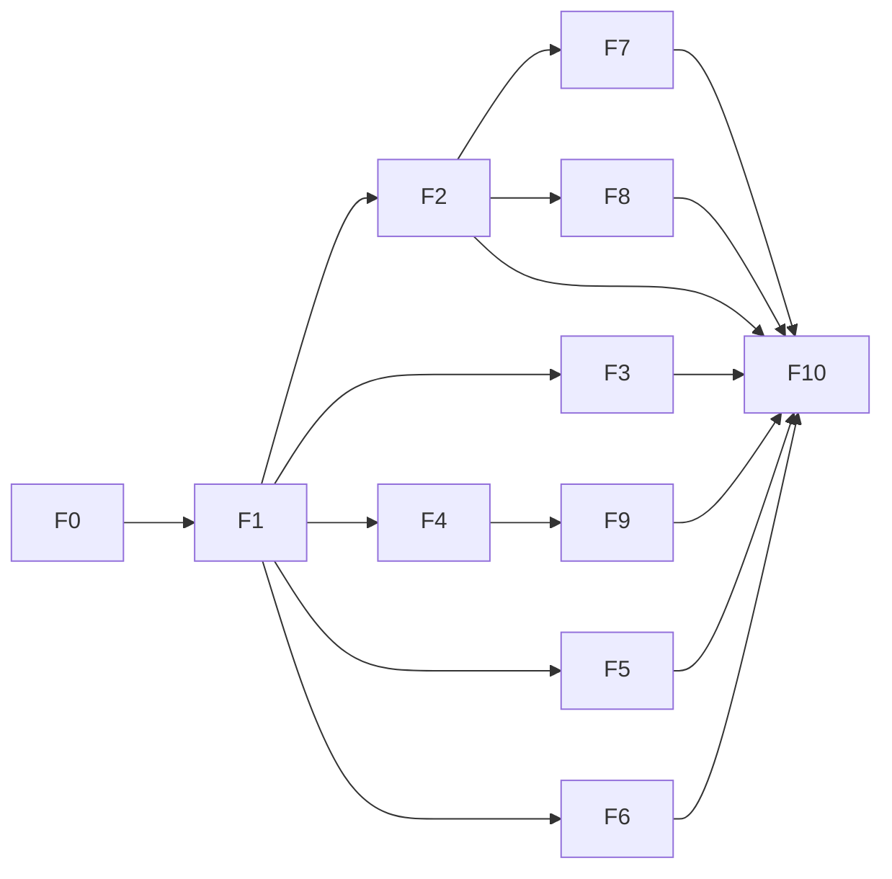

# 12. Roadmap

El desarrollo se divide en once fases. Cada una entrega algo utilizable y tiene un criterio de salida comprobable. No se fijan fechas: el tamaño relativo (S, M, L, XL) orienta el esfuerzo.

## Resumen

| Fase | Nombre | Tamaño | Depende de | Entrega |
|---|---|---|---|---|
| F0 | Fundaciones | S | — | Documentación, ADRs y spikes |
| F1 | Núcleo sin interfaz | L | F0 | `apifast send` desde un archivo |
| F2 | GUI mínima | XL | F1 | Aplicación usable a diario |
| F3 | Bóveda | M | F1 | Secretos cifrados |
| F4 | Tests y runner | L | F1 | Colecciones ejecutables en CI |
| F5 | Red avanzada | L | F1 | Autenticación completa, proxy, certificados |
| F6 | Importación y exportación | M | F1 | Migración desde otras herramientas |
| F7 | GraphQL, SSE y WebSocket | L | F2 | Tres protocolos más |
| F8 | gRPC | L | F2 | gRPC completo |
| F9 | Scripting JavaScript | L | F4 | Scripts compatibles con Bruno |
| F10 | Versión 1.0 | M | Todas | Release estable |

Tras F1, las fases F2 a F6 son en gran parte independientes entre sí. El orden recomendado para una sola persona es el numérico. **Hito "MVP":** F1 + F2 + F3.

---

## F0 — Fundaciones

**Objetivo:** cerrar el diseño y eliminar las incógnitas técnicas antes de escribir código de producto.

### Tareas

- [x] Análisis de Bruno y Yaak.
- [x] Documentación de diseño y ADRs.
- [x] **Spike 1: librería YAML.** Elegida `oneyaml`, guardando con JSON Patch sobre el documento original. Resultados: [spikes/01-libreria-yaml.md](spikes/01-libreria-yaml.md).
- [x] **Spikes 2 y 3: interfaz y renderer.** Elegido egui con wgpu; presupuesto de memoria medido en PSS; edición con resaltado limitada a unos 200 KB. Resultados: [spikes/02-interfaz-egui-vs-iced.md](spikes/02-interfaz-egui-vs-iced.md).
- [x] **Spike 4: compatibilidad con Bruno.** Resuelto leyendo su código: Bruno descarta las claves desconocidas al guardar. Los datos de apifast van en `.apifast/` ([ADR 0002](adr/0002-formato-yaml-opencollection.md)).
- [x] Comprobar en Bruno real que respeta `extensions.bruno.ignore` para `.apifast`. Confirmado en Bruno 4.3.0: [spikes/03-bruno-ignora-apifast.md](spikes/03-bruno-ignora-apifast.md).
- [ ] Medir Bruno y Yaak en la misma máquina (RAM en reposo, arranque) como línea base.
- [x] Crear el workspace de Cargo vacío con CI: formato, lints, pruebas, `cargo deny`; compilación en Linux, macOS y Windows. Esqueletos de los crates de F1, test de reglas de arquitectura (`apifast-arch-tests`) y Rust fijado en `rust-toolchain.toml`.
- [x] Repositorio git inicializado y archivos de licencia (MIT y Apache-2.0).

### Criterio de salida

Cada spike tiene un resultado escrito con cifras, la librería YAML está elegida y el ADR 0004 está confirmado o sustituido.

---

## F1 — Núcleo sin interfaz

**Objetivo:** un esqueleto funcional de extremo a extremo, sin GUI.

### Tareas

- [x] `apifast-domain`: entidades, `Auth`, `Body`, `Setting<T>`, resolución de herencia con procedencia. Solo lo de F1: request HTTP y auth Basic, Bearer y API key; el resto llega en su fase.
- [x] `apifast-template`: parser, árbol reversible, render recursivo, variables dinámicas básicas (`$randomUUID`, `$timestamp`, `$isoTimestamp`, `$randomInt`).
- [x] `apifast-app`: puertos, `OpenCollection`, `LoadRequest`, `SaveRequest`, `ResolveVariables`, `SendRequest`. `RenderedRequest` es el único tipo que acepta el transporte. El watcher de `OpenCollection` llega en F2 y el timeline por canal en F5.
- [x] `apifast-storage-fs`: lectura con `oneyaml` y guardado con JSON Patch por elemento sobre el documento releído del disco; lectura y escritura de `opencollection.yml`, `folder.yml`, requests y entornos; carpeta `.apifast/` con el identificador de colección; escritura atómica; conservación de claves desconocidas. Cada guardado se verifica releyendo el resultado antes de escribir.
- [x] `apifast-http`: envío con reqwest y rustls, redirecciones manuales, timeout, cancelación, cuerpo en streaming a disco. Errores clasificados (DNS, conexión, TLS, timeout, protocolo) sin la URL en el mensaje.
- [x] Autenticación básica: Basic, Bearer, API key, heredada. Se aplica al renderizar, en `apifast-app`; un esquema sin implementar da error en vez de enviar sin auth.
- [x] `apifast-history`: almacén de respuestas en archivos (`FsResponseStore`): escritura por partes con búfer fijo, lectura por ventanas, archivos parciales invisibles hasta terminar y borrados si el envío falla, y limpieza por número, tamaño y antigüedad. El historial de ejecuciones en JSON Lines queda en F2, con su panel.
- [x] `apifast-cli`: `apifast send <archivo> --env <nombre>`, con `--var`, `--allow-unresolved`, `-i`, `--fail` y cancelación con Ctrl+C. El body va a stdout y el resumen a stderr. No escribe nada en la colección.
- [x] Implementaciones en memoria de todos los puertos (`apifast_app::memory`).
- [x] Corpus de round-trip con colecciones YAML de Bruno: 436 archivos copiados al repositorio (los fixtures de Bruno y una colección guardada por la aplicación Bruno 4.3.0), que se guardan sin cambiar un byte, y 1028 ediciones verificadas. Incluye archivos con `config.proxy`, `bundled` y `settings` por defecto.
- [x] Test de reglas de arquitectura (adelantado en F0, `apifast-arch-tests`).

### Criterio de salida

- `apifast send` envía una request leída de un archivo, con variables de entorno, y muestra la respuesta.
- Todos los archivos del corpus se leen y se reescriben sin diferencias.
- El dominio no depende de ningún crate de entrada/salida.

---

## F2 — GUI mínima

**Objetivo:** una aplicación de escritorio con la que trabajar a diario.

### Tareas

- [x] `apifast-gui`: ventana, bucle reactivo, canal de comandos y de instantáneas con el núcleo. La ventana abre una carpeta desde la pantalla de bienvenida o con `apifast-gui <carpeta>`; el selector de carpetas nativo llega con los ajustes.
- [x] Estructura de componentes con atomic design ([UI y UX](09-ui-ux.md#componentes-atomic-design)): tokens en `theme/`, átomos, moléculas, organismos que devuelven eventos, plantillas y pantallas.
- [x] Galería de componentes (`--example gallery`) y pruebas por componente con `egui_kittest`.
- [x] Barra lateral: árbol virtualizado, crear, renombrar, mover, borrar, reordenar. Menú contextual, arrastrar y soltar, y "subir" y "bajar" para hacerlo sin ratón. Crear y renombrar ponen al archivo el *slug* del nombre; mover y reordenar reescriben solo los `seq` que cambian.
- [x] Pestañas con borradores y restauración al abrir. Método y URL ya se editan; `Ctrl+S`, `Ctrl+Shift+S` y `Ctrl+W`; cerrar una pestaña con cambios pide confirmación. Enviar usa lo que hay en pantalla, guardado o no.
- [x] Barra de URL con resaltado de variables. Las definidas van sobre un tinte de su color, las que faltan subrayadas y las que se generan al enviar en otro color. Al pasar el cursor se ven el valor (los secretos, ocultos) y el ámbito de origen. El átomo `TemplateField` sirve también para los demás campos con plantillas.
- [x] Panel de request: Params, Headers, Body (JSON, texto, formulario), Auth, Ajustes. La query de la URL y la tabla de params se mantienen sincronizadas, y los params de ruta salen de los segmentos `:nombre`. Los headers heredados aparecen atenuados con su origen y tachados si la request los sustituye; la auth y cada ajuste muestran de quién heredan. Los bodies multipart y de archivo se muestran, pero todavía no se editan.
- [x] Tablas clave/valor con edición masiva: casilla, nombre, valor con resaltado, quitar y fila vacía al final. Un interruptor las pasa a texto (`nombre: valor` por línea, `//` para las desactivadas) y las filas siguen al texto mientras se escribe. Se sugieren nombres de header conocidos y, tras `{{`, las variables definidas: flechas para elegir, Enter o clic para aceptar, Esc para cerrar.
- [x] Editor de código con resaltado y formateo, con límite de unos 200 KB para la edición con resaltado. Colorea JSON, XML y SPARQL, y encima las variables como en la barra de URL, con el mismo hover. El botón Format o `Alt+Shift+F` formatean JSON y XML con dos espacios aunque haya `{{variables}}` donde va un valor; si la estructura está rota, dice en qué línea. El resaltado se guarda hasta que cambia el texto, y por encima de 200 KB el body se edita sin resaltar. Buscar y reemplazar queda pendiente.
- [x] Visor de respuestas por ventanas; si el texto de egui no alcanza el presupuesto, dibujo wgpu propio con `PaintCallback`. No hizo falta: con 100 MB, desplazarse cuesta unos 0,2 ms de CPU por frame con el texto de egui. El visor lee el body del `ResponseStore` sin guardarlo en memoria. Lo indexa 8 MB por frame, mostrando ya lo que tiene, y parte las líneas de más de 2 KB en filas. Guarda un punto de control cada 64 filas (unos 3 MB para 100 MB de líneas cortas) y en cada frame lee solo las filas visibles. La instantánea ya no copia los primeros 256 KB de cada respuesta.
- [x] Panel de respuesta: Body por ventanas, Headers, Timeline básico. Detecta el lenguaje por `Content-Type` o por cómo empieza el body, y muestra JSON y XML de hasta 2 MB formateados y coloreados ("Pretty"). Cualquier body se ve tal cual ("Raw") por ventanas. Los binarios se anuncian en vez de dibujarse, y un botón copia el body entero (hasta 16 MB). El transporte anota en `ResponseHead::timeline`, en microsegundos, cada request que sale, cada redirección seguida, la llegada de los headers y el final del body.
- [x] Historial de ejecuciones en JSON Lines (`HistoryStore` en `apifast-history`, ADR 0008) y su panel; limpieza de respuestas al arrancar con `FsResponseStore::prune`.
  - Cada envío terminado deja una línea: la request tal como está escrita, y la cabecera, la Timeline y el id del body, o el error. Los cancelados no dejan línea.
  - Al abrir la colección, una tarea aparte recorta el historial (1000 entradas, 30 días) y las respuestas (1000, 512 MB, 30 días). Después restaura la última respuesta de cada pestaña abierta.
  - La barra lateral tiene una pestaña History, filtrable, con las entradas más nuevas arriba; elegir una muestra esa respuesta en la pestaña de su request.
  - Las líneas ilegibles se saltan y desaparecen al recortar.
- [x] Selector y editor de entornos; vista de variables con procedencia.
  - El selector muestra el color del entorno activo.
  - El editor se abre con `Ctrl+E` o con el botón Environments. Tiene la lista de entornos a la izquierda (crear) y, a la derecha, el entorno elegido: nombre (Enter para renombrar), color, `extends` y la tabla de variables (casilla, nombre, valor con resaltado, tipo, secreto, quitar).
  - Los cambios van a una copia que se guarda con Save o se descarta con Revert. Borrar pide confirmación.
  - Renombrar sigue a los entornos que lo extienden, y su archivo pasa a llamarse como el entorno, como en Bruno. No se puede borrar un entorno que otro extiende, ni guardar un `extends` que no existe o forma un ciclo.
  - La vista All variables muestra cada variable que ve la request activa, con su valor, de dónde viene y qué ámbitos sustituye.
  - Marcar una variable como secreta espera a la bóveda (F3): sin ella, solo borraría el valor del archivo.
- [x] `apifast-watch`: recarga ante cambios externos y resolución de conflictos con borradores.
  - `FsWatcher` (con `notify`) agrupa las ráfagas: espera 200 ms de calma, con un máximo de 2 s, y entrega rutas relativas. Ignora `.git`, `.apifast`, `node_modules` y los temporales de editores y de las escrituras atómicas propias.
  - El núcleo relee el árbol y, si cambió `opencollection.yml`, un `folder.yml`, `.env` o `environments/`, también los entornos y lo heredado.
  - Para cada pestaña abierta cuyo archivo cambió:
    - si el archivo dice lo mismo que ya tiene, era una escritura propia y no se hace nada;
    - si no tiene borrador, toma lo nuevo;
    - si tiene borrador, mantiene el borrador en pantalla y ofrece "Keep my changes" o "Load from disk";
    - si el archivo se borró, se cierra si estaba limpia, y con borrador se queda (guardar lo vuelve a escribir).
- [ ] Paleta de comandos y atajos reasignables.
- [ ] Temas claro y oscuro.
- [ ] Ajustes de la aplicación.

### Criterio de salida

- El flujo crear → editar → guardar → enviar → inspeccionar funciona sin tocar archivos a mano.
- Se cumplen los presupuestos de RAM en reposo y de arranque.
- Un cambio hecho con otro editor o con git se refleja sin reiniciar.

---

## F3 — Bóveda

**Objetivo:** ningún secreto en claro.

### Tareas

- [ ] `apifast-vault`: sobre XChaCha20-Poly1305 con datos asociados y vector fijo de prueba.
- [ ] `KeyStore` sobre keyring, con respaldo en archivo `0600` e indicador en la interfaz.
- [ ] Clave de colección: generación, envoltura, *challenge*.
- [ ] Secretos solo locales (por defecto) y secretos compartidos en `.apifast/secrets/`; detección de entradas huérfanas.
- [ ] Clave compartible: exportar, importar y validar.
- [ ] Rotación de clave y conversión entre modelos.
- [ ] Tipo `Secret` y enmascarado en timeline, historial, logs y CLI.
- [ ] Interfaz: columna de clase de secreto, revelar, diálogos de clave, estado de la bóveda.
- [ ] CLI: `apifast vault` y `APIFAST_COLLECTION_KEY`.
- [ ] Cifrado del tarro de cookies.

### Criterio de salida

- Buscar un secreto conocido en la colección, el directorio de datos y los logs no devuelve resultados.
- Una clave incorrecta se detecta y un valor manipulado no se descifra.
- Dos usuarios comparten una colección con secretos intercambiando solo la clave.

---

## F4 — Tests y runner

**Objetivo:** usar una colección como suite de pruebas.

### Tareas

- [ ] Rutas en variables de tipo objeto (`{{user.address.city}}`), que necesitan las capturas: requiere leer JSON fuera del dominio o un lector propio en `apifast-template`. Pasado desde F1.
- [ ] Variables dinámicas de datos de prueba (`$randomEmail`, `$randomFullName`, `$randomWord`). Pasado desde F1.
- [ ] Evaluador de aserciones con todos los operadores.
- [ ] Capturas con selector JSON; variables de runtime.
- [ ] Funciones de plantilla `response` y `header`, con política de refresco y detección de ciclos.
- [ ] JSONPath y XPath.
- [ ] Caso de uso `RunCollection`: orden, tags, pausa, `--bail`, iteraciones.
- [ ] Ejecución dirigida por datos (CSV y JSON).
- [ ] `apifast run` con reporters de consola, JSON, JUnit y HTML.
- [ ] Interfaz: pestaña Tests, resultados en la respuesta, vista del runner.
- [ ] Filtro de respuesta por JSONPath o XPath en el visor.

### Criterio de salida

- Una colección de ejemplo se ejecuta en un pipeline de CI y falla con código 1 cuando una aserción falla.
- El informe JUnit se muestra correctamente en un sistema de CI.

---

## F5 — Red avanzada

**Objetivo:** cubrir los escenarios de red de entornos corporativos.

### Tareas

- [ ] Digest, NTLM y AWS SigV4.
- [ ] OAuth 2.0: authorization code con PKCE, client credentials, password; caché cifrada y refresco.
- [ ] Proxy: sistema y manual (HTTP, HTTPS, SOCKS5), exclusiones, por colección.
- [ ] Autoridades certificadoras adicionales y certificados cliente por host.
- [ ] Tarro de cookies con editor.
- [ ] Sobrescrituras de DNS.
- [ ] Timeline completo con conector instrumentado (DNS, conexión, TLS, reutilización).
- [ ] Descompresión manual, para registrar el tamaño comprimido y el descomprimido (en F1 la hace reqwest).
- [ ] Respetar `encodeUrl: false` (en F1 la URL siempre se normaliza al enviarla).
- [ ] Multipart y cuerpos de archivo en streaming.
- [ ] Ejemplos de respuesta guardados.

### Criterio de salida

- Cada tipo de autenticación tiene una prueba de integración contra un servidor local.
- El timeline muestra tiempos de DNS, conexión y TLS con el pool de conexiones activo.

---

## F6 — Importación y exportación

**Objetivo:** que migrar a apifast sea sencillo.

### Tareas

- [ ] Importadores: Bruno `.bru`, Postman (colecciones y entornos), Insomnia, OpenAPI 3, cURL.
- [ ] Plan de importación revisable: qué se crea, avisos, elementos no soportados.
- [ ] Reimportación que actualiza en lugar de duplicar.
- [ ] Pegar un comando cURL en la barra de URL crea la request.
- [ ] Copiar como cURL.
- [ ] Exportar a Postman.
- [ ] Generación de código para los lenguajes más usados (a decidir según demanda).

### Criterio de salida

Una colección real de cada origen se importa y sus requests se envían correctamente; lo no soportado se informa de forma explícita.

---

## F7 — GraphQL, SSE y WebSocket

### Tareas

- [ ] GraphQL: editores de query y variables, introspección en caché, explorador de esquema, autocompletado.
- [ ] SSE: parseo en vivo y visor de eventos.
- [ ] `apifast-ws`: conectar, enviar, cerrar; historial de mensajes; herencia de headers y autenticación.
- [ ] Formato de archivo para requests `graphql` y `websocket`.

### Criterio de salida

Cada protocolo tiene su editor y su visor, y sus archivos pasan el round-trip.

---

## F8 — gRPC

### Tareas

- [ ] `apifast-grpc`: reflection (v1 y v1alpha) y carga de `.proto`.
- [ ] Decidir cómo compilar `.proto` sin un `protoc` externo.
- [ ] Unario, streaming de servidor, de cliente y bidireccional.
- [ ] Editor de mensajes JSON con esquema para autocompletar.
- [ ] Metadata, TLS y autenticación reutilizando el motor.
- [ ] Inicialización diferida y feature de Cargo.

### Criterio de salida

Los cuatro modos funcionan contra un servidor de pruebas, y abrir la aplicación sin usar gRPC no aumenta la memoria.

---

## F9 — Scripting JavaScript

### Tareas

- [ ] `apifast-script-js` con QuickJS, límites de tiempo y memoria.
- [ ] API `req`, `res`, `bru`, `test` y `expect`.
- [ ] Scripts de colección, carpeta y request con orden "sándwich".
- [ ] Editor de scripts con resaltado.
- [ ] Traducción de scripts de Postman en el importador.
- [ ] Carga del motor solo al ejecutar el primer script.

### Criterio de salida

Las colecciones de prueba de Bruno con scripts se ejecutan con los mismos resultados, y una colección sin scripts no carga el motor.

---

## F10 — Versión 1.0

### Tareas

- [ ] Integración con git: estado, diff semántico por request, commit, cambio de rama.
- [ ] Empaquetado para Linux (AppImage, Flatpak, paquetes); pulido y empaquetado de macOS y Windows.
- [ ] Actualizaciones.
- [ ] Traducciones: español e inglés.
- [ ] Guía de usuario.
- [ ] Auditoría de seguridad de la bóveda.
- [ ] Revisión final de presupuestos de rendimiento.

### Criterio de salida

Todos los presupuestos de [rendimiento](10-rendimiento-y-memoria.md) se cumplen en las tres plataformas, y no quedan errores críticos abiertos.

---

## Después de la 1.0

Ideas sin compromiso:

- Extensiones mediante WebAssembly (nunca un proceso auxiliar permanente).
- Integración con gestores de secretos externos (Vault, 1Password, gestores de nube).
- Passphrase como alternativa al archivo `0600` cuando no hay keyring.
- HTTP/3.
- Servidor MCP para que asistentes de IA usen las colecciones.
- Pruebas de carga básicas.
- Servidor de mocks a partir de los ejemplos guardados.

---

## Riesgos principales

| Riesgo | Impacto | Fase | Mitigación |
|---|---|---|---|
| Escribir en bodies grandes es lento en egui (41 ms por tecla con 1 MB) | Medio | F2 | Límite de 200 KB para la edición con resaltado; visor de solo lectura para lo demás |
| Sin GPU, egui usa unos 98 MB y mucha CPU | Bajo | F2, F10 | Aceptado; se revisa si el uso sin GPU pasa a ser requisito ([ADR 0004](adr/0004-egui-como-ui.md)) |
| `oneyaml` es reciente y puede tener errores o quedar sin mantenimiento | Medio | F1 | Aislada en `apifast-storage-fs`; corpus de round-trip; plan alternativo con `serde-saphyr` |
| Bruno renombra entornos o variables y deja secretos compartidos huérfanos | Bajo | F3 | Detección y reasignación en el editor de entornos |
| OpenCollection cambia de forma incompatible | Medio | Todas | Fijar la versión soportada y añadir migraciones |
| El keyring no está disponible en algunos entornos Linux | Medio | F3 | Respaldo en archivo `0600`, señalado en la interfaz |
| OAuth 2.0 tiene demasiadas variantes | Medio | F5 | Empezar por los tres flujos más usados |
| gRPC aumenta mucho el binario | Medio | F8 | Feature opcional |
| El alcance crece antes del MVP | Alto | F1–F3 | El MVP es F1 + F2 + F3; lo demás espera |

## Cómo se actualiza este documento

- Las casillas se marcan al completar cada tarea.
- Un cambio de alcance o de orden se anota aquí con su motivo.
- Los resultados de los spikes se enlazan desde la fase F0.
