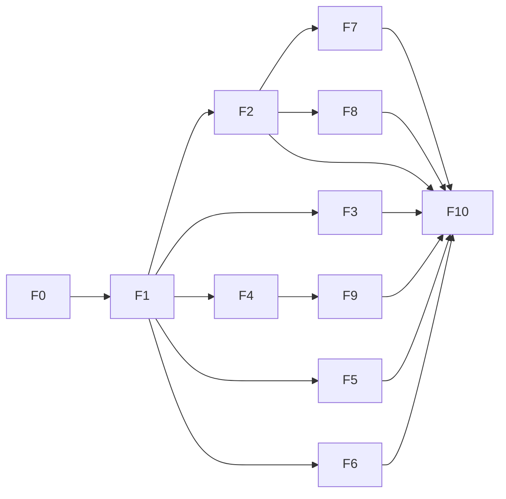

# 12. Roadmap

El desarrollo se divide en once fases. Cada una entrega algo utilizable y tiene un criterio de salida comprobable. No se fijan fechas: el tamaño relativo (S, M, L, XL) orienta el esfuerzo.

## Resumen

| Fase | Nombre | Tamaño | Depende de | Entrega |
|---|---|---|---|---|
| F0 | Fundaciones | S | — | Documentación, ADRs y spikes |
| F1 | Núcleo sin interfaz | L | F0 | `apifast send` desde un archivo |
| F2 | GUI mínima | XL | F1 | Aplicación usable a diario |
| F3 | Bóveda | M | F1 | Secretos cifrados |
| F4 | Tests y runner | L | F1 | Colecciones ejecutables en CI |
| F5 | Red avanzada | L | F1 | Autenticación completa, proxy, certificados |
| F6 | Importación y exportación | M | F1 | Migración desde otras herramientas |
| F7 | GraphQL, SSE y WebSocket | L | F2 | Tres protocolos más |
| F8 | gRPC | L | F2 | gRPC completo |
| F9 | Scripting JavaScript | L | F4 | Scripts compatibles con Bruno |
| F10 | Versión 1.0 | M | Todas | Release estable |

Tras F1, las fases F2 a F6 son en gran parte independientes entre sí. El orden recomendado para una sola persona es el numérico. **Hito "MVP":** F1 + F2 + F3.

---

## F0 — Fundaciones

**Objetivo:** cerrar el diseño y eliminar las incógnitas técnicas antes de escribir código de producto.

### Tareas

- [x] Análisis de Bruno y Yaak.
- [x] Documentación de diseño y ADRs.
- [x] **Spike 1: librería YAML.** Elegida `oneyaml`, guardando con JSON Patch sobre el documento original. Resultados: [spikes/01-libreria-yaml.md](spikes/01-libreria-yaml.md).
- [x] **Spikes 2 y 3: interfaz y renderer.** Elegido egui con wgpu; presupuesto de memoria medido en PSS; edición con resaltado limitada a unos 200 KB. Resultados: [spikes/02-interfaz-egui-vs-iced.md](spikes/02-interfaz-egui-vs-iced.md).
- [x] **Spike 4: compatibilidad con Bruno.** Resuelto leyendo su código: Bruno descarta las claves desconocidas al guardar. Los datos de apifast van en `.apifast/` ([ADR 0002](adr/0002-formato-yaml-opencollection.md)).
- [x] Comprobar en Bruno real que respeta `extensions.bruno.ignore` para `.apifast`. Confirmado en Bruno 4.3.0: [spikes/03-bruno-ignora-apifast.md](spikes/03-bruno-ignora-apifast.md).
- [ ] Medir Bruno y Yaak en la misma máquina (RAM en reposo, arranque) como línea base.
- [x] Crear el workspace de Cargo vacío con CI: formato, lints, pruebas, `cargo deny`; compilación en Linux, macOS y Windows. Esqueletos de los crates de F1, test de reglas de arquitectura (`apifast-arch-tests`) y Rust fijado en `rust-toolchain.toml`.
- [x] Repositorio git inicializado y archivos de licencia (MIT y Apache-2.0).

### Criterio de salida

Cada spike tiene un resultado escrito con cifras, la librería YAML está elegida y el ADR 0004 está confirmado o sustituido.

---

## F1 — Núcleo sin interfaz

**Objetivo:** un esqueleto funcional de extremo a extremo, sin GUI.

### Tareas

- [x] `apifast-domain`: entidades, `Auth`, `Body`, `Setting<T>`, resolución de herencia con procedencia. Solo lo de F1: request HTTP y auth Basic, Bearer y API key; el resto llega en su fase.
- [x] `apifast-template`: parser, árbol reversible, render recursivo, variables dinámicas básicas (`$randomUUID`, `$timestamp`, `$isoTimestamp`, `$randomInt`).
- [x] `apifast-app`: puertos, `OpenCollection`, `LoadRequest`, `SaveRequest`, `ResolveVariables`, `SendRequest`. `RenderedRequest` es el único tipo que acepta el transporte. El watcher de `OpenCollection` llega en F2 y el timeline por canal en F5.
- [x] `apifast-storage-fs`: lectura con `oneyaml` y guardado con JSON Patch por elemento sobre el documento releído del disco; lectura y escritura de `opencollection.yml`, `folder.yml`, requests y entornos; carpeta `.apifast/` con el identificador de colección; escritura atómica; conservación de claves desconocidas. Cada guardado se verifica releyendo el resultado antes de escribir.
- [x] `apifast-http`: envío con reqwest y rustls, redirecciones manuales, timeout, cancelación, cuerpo en streaming a disco. Errores clasificados (DNS, conexión, TLS, timeout, protocolo) sin la URL en el mensaje.
- [x] Autenticación básica: Basic, Bearer, API key, heredada. Se aplica al renderizar, en `apifast-app`; un esquema sin implementar da error en vez de enviar sin auth.
- [x] `apifast-history`: almacén de respuestas en archivos (`FsResponseStore`): escritura por partes con búfer fijo, lectura por ventanas, archivos parciales invisibles hasta terminar y borrados si el envío falla, y limpieza por número, tamaño y antigüedad. El historial de ejecuciones en JSON Lines queda en F2, con su panel.
- [x] `apifast-cli`: `apifast send <archivo> --env <nombre>`, con `--var`, `--allow-unresolved`, `-i`, `--fail` y cancelación con Ctrl+C. El body va a stdout y el resumen a stderr. No escribe nada en la colección.
- [x] Implementaciones en memoria de todos los puertos (`apifast_app::memory`).
- [x] Corpus de round-trip con colecciones YAML de Bruno: 436 archivos copiados al repositorio (los fixtures de Bruno y una colección guardada por la aplicación Bruno 4.3.0), que se guardan sin cambiar un byte, y 1028 ediciones verificadas. Incluye archivos con `config.proxy`, `bundled` y `settings` por defecto.
- [x] Test de reglas de arquitectura (adelantado en F0, `apifast-arch-tests`).

### Criterio de salida

- `apifast send` envía una request leída de un archivo, con variables de entorno, y muestra la respuesta.
- Todos los archivos del corpus se leen y se reescriben sin diferencias.
- El dominio no depende de ningún crate de entrada/salida.

---

## F2 — GUI mínima

**Objetivo:** una aplicación de escritorio con la que trabajar a diario.

**Estado:** completada el 2026-11-16.

### Tareas

- [x] `apifast-gui`: ventana, bucle reactivo, canal de comandos y de instantáneas con el núcleo. La ventana abre una carpeta desde la pantalla de bienvenida o con `apifast-gui <carpeta>`; el botón "Browse..." abre el selector de carpetas del sistema (`rfd`, por el portal de escritorio en Linux).
- [x] Estructura de componentes con atomic design ([UI y UX](09-ui-ux.md#componentes-atomic-design)): tokens en `theme/`, átomos, moléculas, organismos que devuelven eventos, plantillas y pantallas.
- [x] Galería de componentes (`--example gallery`) y pruebas por componente con `egui_kittest`.
- [x] Barra lateral: árbol virtualizado, crear, renombrar, mover, borrar, reordenar. Menú contextual, arrastrar y soltar, y "subir" y "bajar" para hacerlo sin ratón. Crear y renombrar ponen al archivo el *slug* del nombre; mover y reordenar reescriben solo los `seq` que cambian.
- [x] Pestañas con borradores y restauración al abrir. Método y URL ya se editan; `Ctrl+S`, `Ctrl+Shift+S` y `Ctrl+W`; cerrar una pestaña con cambios pide confirmación. Enviar usa lo que hay en pantalla, guardado o no.
- [x] Barra de URL con resaltado de variables. Las definidas van sobre un tinte de su color, las que faltan subrayadas y las que se generan al enviar en otro color. Al pasar el cursor se ven el valor (los secretos, ocultos) y el ámbito de origen. El átomo `TemplateField` sirve también para los demás campos con plantillas.
- [x] Panel de request: Params, Headers, Body (JSON, texto, formulario), Auth, Ajustes. La query de la URL y la tabla de params se mantienen sincronizadas, y los params de ruta salen de los segmentos `:nombre`. Los headers heredados aparecen atenuados con su origen y tachados si la request los sustituye; la auth y cada ajuste muestran de quién heredan. Los bodies multipart y de archivo se muestran, pero todavía no se editan.
- [x] Tablas clave/valor con edición masiva: casilla, nombre, valor con resaltado, quitar y fila vacía al final. Un interruptor las pasa a texto (`nombre: valor` por línea, `//` para las desactivadas) y las filas siguen al texto mientras se escribe. Se sugieren nombres de header conocidos y, tras `{{`, las variables definidas: flechas para elegir, Enter o clic para aceptar, Esc para cerrar.
- [x] Editor de código con resaltado y formateo, con límite de unos 200 KB para la edición con resaltado. Colorea JSON, XML y SPARQL, y encima las variables como en la barra de URL, con el mismo hover. El botón Format o `Alt+Shift+F` formatean JSON y XML con dos espacios aunque haya `{{variables}}` donde va un valor; si la estructura está rota, dice en qué línea. El resaltado se guarda hasta que cambia el texto, y por encima de 200 KB el body se edita sin resaltar. Buscar y reemplazar queda pendiente.
- [x] Visor de respuestas por ventanas; si el texto de egui no alcanza el presupuesto, dibujo wgpu propio con `PaintCallback`. No hizo falta: con 100 MB, desplazarse cuesta unos 0,2 ms de CPU por frame con el texto de egui. El visor lee el body del `ResponseStore` sin guardarlo en memoria. Lo indexa 8 MB por frame, mostrando ya lo que tiene, y parte las líneas de más de 2 KB en filas. Guarda un punto de control cada 64 filas (unos 3 MB para 100 MB de líneas cortas) y en cada frame lee solo las filas visibles. La instantánea ya no copia los primeros 256 KB de cada respuesta.
- [x] Panel de respuesta: Body por ventanas, Headers, Timeline básico. Detecta el lenguaje por `Content-Type` o por cómo empieza el body, y muestra JSON y XML de hasta 2 MB formateados y coloreados ("Pretty"). Cualquier body se ve tal cual ("Raw") por ventanas. Los binarios se anuncian en vez de dibujarse, y un botón copia el body entero (hasta 16 MB). El transporte anota en `ResponseHead::timeline`, en microsegundos, cada request que sale, cada redirección seguida, la llegada de los headers y el final del body.
- [x] Historial de ejecuciones en JSON Lines (`HistoryStore` en `apifast-history`, ADR 0008) y su panel; limpieza de respuestas al arrancar con `FsResponseStore::prune`.
  - Cada envío terminado deja una línea: la request tal como está escrita, y la cabecera, la Timeline y el id del body, o el error. Los cancelados no dejan línea.
  - Al abrir la colección, una tarea aparte recorta el historial (1000 entradas, 30 días) y las respuestas (1000, 512 MB, 30 días). Después restaura la última respuesta de cada pestaña abierta.
  - La barra lateral tiene una pestaña History, filtrable, con las entradas más nuevas arriba; elegir una muestra esa respuesta en la pestaña de su request.
  - Las líneas ilegibles se saltan y desaparecen al recortar.
- [x] Selector y editor de entornos; vista de variables con procedencia.
  - El selector muestra el color del entorno activo.
  - El editor se abre con `Ctrl+E` o con el botón Environments. Tiene la lista de entornos a la izquierda (crear) y, a la derecha, el entorno elegido: nombre (Enter para renombrar), color, `extends` y la tabla de variables (casilla, nombre, valor con resaltado, tipo, secreto, quitar).
  - Los cambios van a una copia que se guarda con Save o se descarta con Revert. Borrar pide confirmación.
  - Renombrar sigue a los entornos que lo extienden, y su archivo pasa a llamarse como el entorno, como en Bruno. No se puede borrar un entorno que otro extiende, ni guardar un `extends` que no existe o forma un ciclo.
  - La vista All variables muestra cada variable que ve la request activa, con su valor, de dónde viene y qué ámbitos sustituye.
  - Marcar una variable como secreta espera a la bóveda (F3): sin ella, solo borraría el valor del archivo.
- [x] `apifast-watch`: recarga ante cambios externos y resolución de conflictos con borradores.
  - `FsWatcher` (con `notify`) agrupa las ráfagas: espera 200 ms de calma, con un máximo de 2 s, y entrega rutas relativas. Ignora `.git`, `.apifast`, `node_modules` y los temporales de editores y de las escrituras atómicas propias.
  - El núcleo relee el árbol y, si cambió `opencollection.yml`, un `folder.yml`, `.env` o `environments/`, también los entornos y lo heredado.
  - Para cada pestaña abierta cuyo archivo cambió:
    - si el archivo dice lo mismo que ya tiene, era una escritura propia y no se hace nada;
    - si no tiene borrador, toma lo nuevo;
    - si tiene borrador, mantiene el borrador en pantalla y ofrece "Keep my changes" o "Load from disk";
    - si el archivo se borró, se cierra si estaba limpia, y con borrador se queda (guardar lo vuelve a escribir).
- [x] Paleta de comandos y atajos reasignables.
  - Todas las acciones están en un registro único (`actions.rs`), con su nombre estable para `keymap.yml` y sus atajos por defecto. Funcionan los de la tabla de `docs/09-ui-ux.md` salvo Duplicar, Renombrar, Filtrar barra lateral y Cambiar disposición, que esperan a sus funciones; el zoom lo da egui.
  - `Ctrl+K` abre la paleta: acciones con su atajo, requests y entornos, con búsqueda difusa y lo último elegido primero. `Ctrl+P` busca solo requests.
  - El editor de atajos (desde la paleta, "Keyboard shortcuts") cambia uno pulsando la combinación nueva, avisa si se la quita a otra acción y permite restablecer el predeterminado.
  - `~/.config/apifast/keymap.yml` guarda solo lo que difiere de lo predeterminado; las entradas que no se entienden se ignoran y se avisa en pantalla.
- [x] Temas claro y oscuro.
  - Por defecto se sigue el tema del sistema. Desde la paleta se elige "Theme: follow the system", "light" o "dark"; las tres acciones admiten atajo. La elección se guarda con los ajustes.
  - Repaso visual con capturas renderizadas en los dos temas:
    - Las tablas clave/valor y la de variables ya no usan `egui::Grid`: un campo en una celda solo recibe el ancho que su columna midió antes, así que nunca crecía (nombres cortados y valores partidos en varias líneas). Ahora las filas se reparten el ancho disponible.
    - Las ventanas usan el color de fondo y los campos el de superficie, con borde: en el tema claro los campos dentro de una ventana no se veían.
    - Los botones de cerrar y quitar son el átomo `CloseButton`: una × dibujada, sin fondo hasta pasar el ratón.
- [x] Ajustes de la aplicación.
  - Ventana Settings (`Ctrl+,` o desde la paleta):
    - tema y escala de la interfaz (también `Ctrl+=`, `Ctrl+-` y `Ctrl+0`, que se guardan igual);
    - tamaño máximo de un body en la vista Pretty;
    - entradas del historial, días que se conservan y espacio para cuerpos de respuesta;
    - un botón para restablecer los valores por defecto.
  - Se guardan en `~/.config/apifast/settings.yml` al cambiar, en un hilo aparte, y al soltar el ratón si se arrastra un control.
  - Los límites de almacenamiento llegan al núcleo con `Command::Configure` antes de abrir la colección y se aplican al abrirla.
  - Los valores fuera de rango se ajustan al rango; los que no se entienden se ignoran y se avisa en pantalla.

### Criterio de salida

- El flujo crear → editar → guardar → enviar → inspeccionar funciona sin tocar archivos a mano.
- Se cumplen los presupuestos de RAM en reposo y de arranque.
- Un cambio hecho con otro editor o con git se refleja sin reiniciar.

**Resultado:** los tres se cumplen.

- El flujo completo lo recorren las pruebas de `apifast-gui` (`tests/flow.rs` contra un servidor real, y `tests/core.rs`): crear, editar, guardar, enviar e inspeccionar, sin tocar archivos.
- Presupuestos medidos con `tools/bench/`: 50 MB PSS en reposo con 100 requests, primera ventana en 43–64 ms. Detalle en [rendimiento](10-rendimiento-y-memoria.md#mediciones-de-f2).
- `apifast-watch` refleja los cambios externos; con un borrador, la interfaz pregunta qué conservar.

**Queda fuera de F2**, a retomar en la fase que lo necesite o en un repaso de la interfaz:

| Pendiente | Motivo |
|---|---|
| Buscar y reemplazar en el editor | No bloquea el uso diario |
| Duplicar, renombrar con `F2`, filtro `Ctrl+F` y disposición lado a lado (`Ctrl+J`) | Funciones de la barra lateral y del diseño aún sin hacer; sus atajos se añaden con ellas |
| Autocompletado de variables en el editor de varias líneas | Enter y las flechas chocan con la edición |
| Entorno "de cuidado" que tiñe la barra | OpenCollection no tiene esa marca; falta decidir dónde guardarla |
| Marcar variables como secretas | Llega con la bóveda (F3) |
| Selector de respuestas anteriores en el panel de respuesta | El historial ya permite abrirlas |
| Bloqueo de archivo del historial entre dos instancias | Cada línea se escribe de una vez; basta en la práctica |
| Contraste 3:1 de los bordes de los campos | Los campos se distinguen por el fondo; se revisará en el repaso de accesibilidad |

---

## F3 — Bóveda

**Objetivo:** ningún secreto en claro.

**Estado:** completada el 2026-11-16.

### Tareas

- [x] `apifast-vault`: sobre XChaCha20-Poly1305 con datos asociados y vector fijo de prueba. El cifrado se comprueba con el vector publicado (apéndice A.3.1 de `draft-irtf-cfrg-xchacha-03`) y el formato `enc:v1:` con un vector propio. Un valor abierto con otra clave, otra variable, otro entorno u otra colección, o con un byte cambiado, se rechaza. Las claves se borran de memoria al liberarse y no se imprimen.
- [x] `KeyStore` sobre keyring, con respaldo en archivo `0600` e indicador en la interfaz. La clave maestra se busca en el keyring (crate `keyring`, Secret Service en Linux) y luego en `master.key`; una nueva va al keyring, o al archivo si el sistema no tiene keyring. Un keyring que existe pero falla o está bloqueado es un error, nunca un paso al archivo. `master_key` devuelve dónde está la clave para el indicador, que se dibujará con la interfaz de la bóveda.
- [x] Clave de colección: generación, envoltura, *challenge*. `CollectionKeyStore` guarda cada clave en `keys/<collection-id>.key`, cifrada con la maestra y atada a su colección por los datos asociados, con permisos `0600`. El *challenge* son 32 bytes aleatorios cifrados con la clave de la colección, en `vault.challenge` de `.apifast/collection.yml`; abrirlo dice si una clave es la correcta. Generar la clave al guardar el primer secreto compartido llega con la tarea de secretos.
- [x] Secretos solo locales (por defecto) y secretos compartidos en `.apifast/secrets/`; detección de entradas huérfanas.
  - [x] Solo locales: `vault/<collection-id>.vault` (JSON, `0600`), cada valor en su sobre con la clave maestra y atado a colección, entorno y variable. El envío pide los valores por el puerto `SecretStore`, solo para las variables secretas sin valor; la GUI y la CLI usan `VaultSecrets`, que lee la clave maestra la primera vez que hace falta y nunca la crea al leer.
  - [x] Compartidos en `.apifast/secrets/<entorno>.yml`, con la clave de la colección generada al compartir el primero.
    - El envío busca primero el secreto local y luego el compartido. `apifast-vault` lee los archivos de la colección por el puerto `SharedSecretFiles`, que implementa `FsCollection`.
    - Compartir crea la clave de la colección y el *challenge* la primera vez. Si la colección ya tiene *challenge* y esta máquina no tiene su clave, compartir falla: la clave se pide al equipo, nunca se crea otra.
    - `use_collection_key` acepta la clave del equipo solo si abre el *challenge*.
    - Pasar un secreto de local a compartido o al revés lo quita del otro sitio.
    - Un secreto compartido sin la clave en esta máquina hace fallar el envío con ese motivo, en vez de enviarse sin él.
  - [x] Entradas huérfanas: secretos guardados cuya variable ya no existe o ya no es secreta. `VaultSecrets::orphans` las lista, locales y compartidas, y `forget` las borra; mostrarlas y limpiarlas desde el editor de entornos llega con la interfaz de la bóveda. Al renombrar un entorno, sus secretos se cifran de nuevo con el nombre nuevo (los datos asociados lo incluyen), cada uno en su sitio. Renombrar una variable secreta deja su valor huérfano hasta volver a escribirlo: desde un archivo no se distingue un renombrado de un borrado más un alta.
- [x] Clave compartible: exportar, importar y validar. `AFK-` y 54 caracteres Crockford en 9 grupos de 6: 52 de la clave y 2 de control (10 bits de un CRC-16) que detectan una errata antes de probar la clave. La lectura ignora mayúsculas, guiones y espacios, y toma `I`/`L` por `1` y `O` por `0`. `export_collection_key` la muestra; `import_collection_key` la lee, la valida contra el *challenge* y la guarda.
- [x] Rotación de clave y conversión entre modelos. `rotate_collection_key` abre todos los secretos compartidos antes de escribir nada, guarda la clave nueva y conserva la anterior como `keys/<id>.previous.key` hasta terminar de cifrar de nuevo los secretos y el *challenge*. Si se corta a mitad, los valores se leen con la nueva o con la anterior y basta con repetirla. Devuelve la clave nueva en formato compartible para el equipo. La conversión entre modelos ya la hacen `set_local` y `share`.
- [x] Tipo `Secret` y enmascarado en timeline, historial, logs y CLI.
  - `Secret` (en el dominio) borra su valor de memoria al liberarse y al imprimirse solo muestra `••••••`; la bóveda devuelve los valores así.
  - El render recoge el valor de cada secreto que usa (el valor ya renderizado, si se compone de otras variables). La request renderizada y el resultado del envío lo llevan consigo.
  - `mask` sustituye cada valor, y su forma codificada en URL, por `••••••`.
  - El historial y su Timeline enmascaran las URLs alcanzadas (la final, cada request y cada redirección) y, además, ocultan los valores de su query. La request renderizada se imprime enmascarada, así que no llega a un log.
  - La CLI no imprime nada de la request, solo la respuesta y un resumen sin URL.
  - Queda fuera: el valor existe en memoria como texto normal mientras se renderiza y se envía, y un cuerpo de respuesta que repita un secreto se guarda tal cual (ver `docs/06`).
- [x] Interfaz: columna de clase de secreto, revelar, diálogos de clave, estado de la bóveda.
  - [x] Núcleo: la instantánea lleva la vista de la bóveda (dónde está el valor de cada variable secreta, entradas huérfanas, si la colección comparte secretos y tiene clave, si la maestra está en archivo), calculada solo con nombres: no abre ningún valor ni pregunta al keyring. Comandos para guardar un valor (local o compartido), revelarlo, olvidar una entrada, y mostrar, pegar y rotar la clave; lo revelado y la clave mostrada se ocultan solos a los 15 s. Una colección sin identificador lo recibe al guardar su primer secreto, y su sesión, historial y respuestas pasan del hash de la ruta al identificador. `Core::start_with(.., SystemKeyring::off(), ..)` usa solo el archivo de la clave maestra: así las pruebas nunca tocan el keyring del usuario.
  - [x] Editor de entornos: marcar secreta (local o compartida), escribir el valor oculto, revelar, estado y huérfanas.
    - La casilla Secret ya funciona. Si la variable tenía valor, ese valor se guarda en la bóveda al pulsar Save y el archivo queda solo con el nombre.
    - Cada secreto tiene un campo oculto para escribir un valor nuevo, la casilla Shared (marcada si el valor ya es compartido) y Reveal, activo si hay valor guardado.
    - El estado (guardado aquí, compartido, bloqueado sin la clave o sin valor) aparece en el campo vacío, al pasar el ratón y en su nombre accesible.
    - Save guarda el entorno y los valores escritos, cada uno en su sitio; Revert descarta ambos.
    - Debajo, las entradas huérfanas con un botón Forget.
  - [x] Diálogos de la clave de la colección e indicador de la bóveda.
    - Una colección que comparte secretos sin la clave en esta máquina muestra un aviso con un campo oculto para pegarla.
    - La ventana "Collection key" (desde la paleta) muestra la clave con un botón para copiarla, y la rota tras confirmar lo que implica. Sin secretos compartidos, explica que la clave se crea al compartir el primero.
    - La barra superior avisa cuando la clave maestra está en el archivo de respaldo y no en el keyring.
- [x] CLI: `apifast vault` y `APIFAST_COLLECTION_KEY`. `vault set` (local o `--shared`), `status`, y `key show`, `import` y `rotate`; valores y claves solo por la entrada estándar. `APIFAST_COLLECTION_KEY` abre los secretos compartidos en una ejecución sin guardar la clave, y `APIFAST_NO_KEYRING=1` deja la clave maestra en su archivo.
- [ ] ~~Cifrado del tarro de cookies.~~ Pasa a F5: apifast todavía no guarda cookies, y el tarro llega allí ("Tarro de cookies con editor"). Se cifrará con la clave maestra al crearlo.

### Criterio de salida

- Buscar un secreto conocido en la colección, el directorio de datos y los logs no devuelve resultados.
- Una clave incorrecta se detecta y un valor manipulado no se descifra.
- Dos usuarios comparten una colección con secretos intercambiando solo la clave.

**Resultado:** los tres se cumplen, cada uno con su prueba.

- `apifast-cli/tests/vault.rs` guarda un secreto local y otro compartido, envía requests que los usan y busca sus bytes en todos los archivos de la colección y del directorio de datos y en la salida: no aparecen. Queda fuera, por diseño, el cuerpo de una respuesta que repita un secreto: se guarda tal cual llega ([bóveda](06-boveda-de-secretos.md)).
- Las pruebas del sobre rechazan una clave incorrecta, un valor con un byte cambiado y un valor movido a otra variable, entorno o colección; la clave compartible detecta una errata antes de probarla.
- `apifast-cli/tests/vault.rs` y `apifast-vault/tests/shared.rs` recorren dos máquinas sobre la misma colección: la segunda abre los secretos compartidos con solo la clave, sea pegada o en `APIFAST_COLLECTION_KEY`.

El cifrado del tarro de cookies pasa a F5, donde llega el tarro.

---

## Workspaces y varias colecciones

**Objetivo:** trabajar con varias colecciones a la vez, agrupadas en workspaces compatibles con Bruno, entrando directamente al visor ([ADR 0009](adr/0009-workspaces-y-varias-colecciones.md)).

**Estado:** completada el 2026-11-16. Se intercaló en F4, después de las funciones `response` y `header` y antes de JSONPath; nace de probar la interfaz: sin colección solo había una bienvenida, no se podía crear una colección y abrir otra cerraba la anterior.

### Tareas

- [x] Diseño documentado: ADR 0009, formato de `workspace.yml` y estado local ([formato](04-formato-de-archivos.md)), interfaz ([UI](09-ui-ux.md)), clave de la colección ([bóveda](06-boveda-de-secretos.md)).
- [x] Arranque directo al visor, con estado vacío; crear y abrir colecciones desde dentro (diálogo "New collection", acciones y paleta). Sin pantalla de bienvenida. La barra lateral vacía ofrece "New collection…" y "Open collection…" (también en la paleta; abrir es `Ctrl+O`). El diálogo pide nombre y carpeta padre, que por defecto es la del workspace por defecto (`default-workspace` en el directorio de datos) o la de la colección abierta, y crea `<padre>/<nombre-en-minúsculas-con-guiones>`. Abrir una carpeta sin `opencollection.yml` muestra el error con el botón "Create one here". Crear nunca escribe sobre una colección existente. Hasta la tarea del núcleo, abrir otra colección sigue cerrando la anterior.
- [x] `workspace.yml` en `apifast-storage-fs`: leer, añadir, quitar y renombrar conservando el resto del archivo; estado personal por workspace y lista de workspaces conocidos. Todo `workspace.yml` del corpus de Bruno se guarda byte a byte. Puerto `WorkspaceRepository` (con `MemoryWorkspace`) y adaptador `FsWorkspace`, que reutiliza el guardado por parches de las colecciones: al añadir una colección se respeta hasta el estilo de comillas del archivo. `entry_for` escribe la ruta relativa si la colección está dentro de la carpeta del workspace, y `resolve` la vuelve a absoluta. `FsWorkspaceState` y `FsKnownWorkspaces` guardan lo personal; sus rutas están en `apifast_history::dirs`.
- [x] Núcleo de la GUI con un workspace activo y varias colecciones: pestañas y comandos por colección, carga perezosa, entorno activo por colección, cerrar y quitar colecciones, crear, abrir y cambiar de workspace, restaurar al reiniciar, `workspace.yml` vigilado sin recursión. Las pestañas se identifican por colección y ruta (`TabKey`). El snapshot mantiene los campos de "la colección enfocada" (la de la pestaña activa, o la última elegida), así que la barra superior, los entornos, la bóveda y el historial siguen la pestaña activa sin más cambios. `Restore` abre el último workspace (o crea "My workspace") después de los ajustes; cualquier comando que lo necesite también lo hace. Cerrar una colección guarda sus borradores en su sesión y vuelven al abrir la request. La lista de workspaces conocidos vive en el directorio de datos, no en el de configuración: es estado. `FsWatcher::start_shallow` vigila solo `workspace.yml`. Hasta la tarea de interfaz, el árbol muestra la colección enfocada.
- [x] Interfaz: selector de workspace, una raíz por colección en el árbol con su menú, barra superior e historial de la colección activa, pestañas con su colección, paleta con todas las requests cargadas. El selector de la cabecera de la barra lateral cambia de workspace y ofrece New workspace…, Open workspace… y Rename workspace…; debajo, New collection… y Open collection…. Cada raíz se despliega con un clic (y se carga entonces). Una raíz que no carga se ve en rojo, con el motivo al pasar el ratón, y una que necesita su clave en ámbar. El menú de la raíz tiene New request, New folder, Environments, Collection key, Close, Remove from workspace y Copy folder path. Arrastrar solo funciona dentro de la colección, y soltar sobre la raíz lleva el elemento a su nivel superior. Dos pestañas con el mismo nombre de colecciones distintas llevan delante el nombre de la colección; el tooltip siempre lo dice. "Forget" de un workspace existe en el núcleo pero aún no tiene botón.
- [x] Clave de la colección por colección: nunca se pide a quien la creó ni dos veces en la misma máquina; verla, copiarla y rotarla desde el menú de la raíz. Fijado con pruebas. Una prueba recorre dos máquinas (dos directorios de datos): quien comparte el primer secreto no escribe la clave y, tras reiniciar, no se le pide; la otra máquina ve la marca en la raíz, pega la clave una vez y tras reiniciar ya no se le pide. El aviso para pegarla es el de la colección enfocada.
- [x] Medición de memoria con un workspace de tres colecciones y una cargada. Medido con tres colecciones de 1000 requests sin desplegar: 51,2 MB, lo mismo que con una colección pequeña cargada (52,9 MB). El binario sube a 24,6 MiB, cerca del límite ([rendimiento](10-rendimiento-y-memoria.md)).

Siguiente, fuera de esta sección: los entornos globales del workspace (`environments/` de Bruno) como ámbito `Global`.

### Criterio de salida

- `apifast-gui` sin argumentos entra al visor; desde dentro se crean y abren colecciones y workspaces.
- Dos colecciones abiertas a la vez, cada una con su entorno, y al reiniciar todo vuelve como estaba.
- Un workspace creado en Bruno se abre en apifast con sus colecciones, y uno guardado por apifast se abre en Bruno.
- La clave de una colección no se pide a quien la creó ni a una máquina que ya la importó.

**Resultado:** los cuatro se cumplen. Las pruebas de flujo arrancan sin colección, crean colecciones y un segundo workspace desde la interfaz; las del núcleo cubren dos colecciones con su entorno, el reinicio, cerrar y quitar, el cambio de workspace y la clave en dos máquinas. Los `workspace.yml` del corpus de Bruno se leen y se guardan byte a byte, y lo que apifast escribe usa el mismo formato; abrirlo en Bruno queda por comprobar a mano.

---

## F4 — Tests y runner

**Objetivo:** usar una colección como suite de pruebas.

**Estado:** completada el 2026-11-16. Los dos criterios de salida se comprueban en las pruebas de extremo a extremo de la CLI (`crates/apifast-cli/tests/run.rs`): la ejecución termina con 1 cuando una aserción falla, y el informe JUnit es XML válido con los atributos que leen los sistemas de CI (se valida con XPath). Falta verlo en un pipeline real: el repositorio aún no tiene remoto, así que `.github/workflows/ci.yml` no ha corrido nunca; [docs/08](08-tests-y-runner.md#en-ci) trae el ejemplo para GitHub Actions.

### Tareas

- [x] Rutas en variables de tipo objeto (`{{user.address.city}}`), que necesitan las capturas: requiere leer JSON fuera del dominio o un lector propio en `apifast-template`. Pasado desde F1. Hecho con el lector `Json` del dominio: gana una variable con puntos en su nombre, luego el prefijo más largo; un segmento numérico indexa arrays y el campo de un secreto es secreto.
- [x] Variables dinámicas de datos de prueba (`$randomEmail`, `$randomFullName`, `$randomWord`). Pasado desde F1. Con los nombres de Postman y Bruno: nombre, apellido, nombre completo, usuario, email (siempre en `example.com`), palabra y palabras, ciudad, país, teléfono, booleano y alfanumérico, de listas fijas y con la aleatoriedad del `Host`.
- [x] Evaluador de aserciones con todos los operadores. Las aserciones y capturas de Bruno (`runtime.assertions` y las acciones `set-variable`) se leen y se guardan en su sitio; las acciones de otro tipo se conservan. Un lector JSON propio en el dominio (`Json`) sirve al evaluador y servirá a las rutas en variables objeto. `check` evalúa los 28 operadores contra `ResponseFacts` con conversión al tipo del valor real y mensajes con ambos valores.
- [x] Capturas con selector JSON; variables de runtime. `send_request` ejecuta las capturas y luego las aserciones (con el valor esperado renderizado, ya con lo capturado) y las devuelve enmascaradas en `SendOutcome`. `apply_captures` guarda los valores para los envíos siguientes: la interfaz los mantiene mientras la colección está abierta, y `apifast send` muestra los resultados y termina con 1 si una aserción falla. Las de ámbito `environment` se escriben en el entorno, y las secretas en la bóveda, cuando el usuario lo acepta en la interfaz.
- [x] Funciones de plantilla `response` y `header`, con política de refresco y detección de ciclos. Renderizado por rondas: lo que falta se envía y se vuelve a renderizar, con la misma lógica recursiva, así que también sirven dentro de variables de entorno. `never`, `missing`, `ttl` y `always` sobre la última respuesta del historial; cada dependencia se envía una vez por envío y queda en el historial, que la interfaz muestra. Los ciclos se rechazan antes de enviar nada. `path` admite JSONPath y XPath desde la tarea siguiente.
- [x] JSONPath y XPath. Nuevo crate de dominio `apifast-query`: JSONPath según el RFC 9535 (más la forma `[?(…)]` de Jayway y Bruno) sobre el lector `Json`, y XPath 1.0 completo salvo variables sobre `roxmltree`, con nombres sin prefijo que coinciden en cualquier espacio de nombres. Presupuesto de 20 millones de visitas y anidamiento máximo de 64 por consulta. `response(path=…)` lo usa (varios valores dan un array JSON), y `res.body.<ruta>` en aserciones y capturas pasa a JSONPath cuando la ruta usa su sintaxis.
- [x] Caso de uso `RunCollection`: orden, tags, pausa, `--bail`, iteraciones. `run_collection` en `apifast-app`: colección o carpeta (recursiva o no) en el orden del árbol, tags que incluyen o excluyen, omitidas con su motivo, capturas que pasan de una request a la siguiente, errores que no detienen salvo con `bail`, pausa por un puerto `Pause`, cancelación y eventos de progreso. Devuelve un `RunReport` con totales.
- [x] Ejecución dirigida por datos (CSV y JSON). `parse_data` lee CSV (RFC 4180, con cabecera) o un array JSON de objetos, con errores que dicen la línea o el elemento. `RunOptions.data` hace una iteración por fila, con sus columnas como variables runtime.
- [x] `apifast run` con reporters de consola, JSON, JUnit y HTML. Los reporters son funciones puras de `apifast-app` (para que la interfaz pueda exportarlos); la consola muestra una línea por request en vivo. Códigos de salida 0, 1, 2 y 3, y el 3 pasa a ser el de uso en todos los comandos. Pendiente: `--env-file`; `--insecure` y `--cacert` llegaron con los certificados de F5.
- [x] Interfaz: pestaña Tests, resultados en la respuesta, vista del runner. La pestaña Tests del editor edita aserciones y capturas; la de la respuesta muestra los resultados, los fallos primero; un aviso guarda las capturas de ámbito `environment` en el entorno o, si son secretas, en la bóveda. La ventana del runner ("Run…" en el menú de una colección o carpeta) lanza la ejecución en segundo plano, muestra el progreso y los resultados, abre cada paso con su respuesta y guarda los informes. Corregido de paso: `run_collection` ordena el árbol por `seq`, como la interfaz, y no en el orden de los archivos.
- [x] Filtro de respuesta por JSONPath o XPath en el visor. Un campo sobre el body formateado (JSON o XML, hasta el umbral de 2 MB) con `apifast-query`: el valor o los valores seleccionados, formateados, cuántos son, y el error con su posición si la expresión no vale.

### Criterio de salida

- Una colección de ejemplo se ejecuta en un pipeline de CI y falla con código 1 cuando una aserción falla.
- El informe JUnit se muestra correctamente en un sistema de CI.

---

## F5 — Red avanzada

**Objetivo:** cubrir los escenarios de red de entornos corporativos.

### Tareas

- [x] Digest, NTLM y AWS SigV4. Las tres se aplican en el transporte (`TransportAuth`), sobre la request tal como sale. AWS SigV4 firma cada request al mismo origen; Digest responde al 401 (MD5, SHA-256 y `-sess`, `qop=auth`) reenviando una vez; NTLMv2 hace el intercambio en una conexión, con un cliente HTTP/1.1 propio. Cada una tiene una prueba de integración contra un servidor local, además de los ejemplos oficiales (documentación de AWS, RFC 2617 y 7616, [MS-NLMP] 4.2.4).
- [x] OAuth 2.0: authorization code con PKCE, client credentials, password; caché cifrada y refresco. Por fases:
  - [x] A. Modelo completo (`OAuth2Auth`): se lee y se guarda con el bloque de Bruno, cambiando solo las claves afectadas, y se edita en la pestaña Auth con los campos de cada flujo.
  - [x] B. Obtener y refrescar el token (client credentials y password) y aplicarlo al enviar. Antes de renderizar, el envío toma el token guardado, lo refresca o pide uno nuevo, y lo pone en el header o la query como variable secreta. Por ahora los tokens se guardan en memoria (`MemoryTokens`). Probado con un servidor guionizado (caché, refresco, errores, query, `id_token`) y de extremo a extremo con la CLI contra un servidor OAuth local.
  - [x] C. Caché de tokens cifrada con la clave maestra; ver y borrar el token en la interfaz. `FsTokenStore` sella cada token en `oauth2/<colección>.tokens`, para cualquier colección (no necesita id); la interfaz lo usa y sobrevive a un reinicio, la CLI sigue en memoria. La pestaña Auth muestra el estado del token y obtiene uno nuevo o lo olvida.
  - [x] D. Authorization code con PKCE: navegador del sistema y servidor local temporal para el *callback*. Puerto `Authorizer` en la aplicación y `LoopbackAuthorizer` en el transporte (callback solo en `localhost`, 5 minutos, cancelable); `state` comprobado y PKCE S256. La CLI solo abre el navegador en una terminal.
- [x] Proxy: sistema y manual (HTTP, HTTPS, SOCKS5), exclusiones, por colección. Proxy de la aplicación en los ajustes (sistema, ninguno o manual, con la contraseña sellada aparte) y de cada colección en `config.proxy`, como Bruno (heredar, ninguno o propio), editable en "Collection settings…". HTTP, HTTPS, SOCKS4 y SOCKS5, credenciales y exclusiones; el transporte de cada colección se reconstruye al cambiar. Pendientes: registrarlo en el timeline, `{{variables}}` en sus campos y la configuración de proxy del escritorio.
- [x] Autoridades certificadoras adicionales y certificados cliente por host. CA adicional en los ajustes y `--cacert` (repetible), sin validación con aviso (`--insecure`), y certificados PEM por host (con puerto y comodines) en `config.clientCertificates`, editables en "Collection settings…": un cliente por certificado, elegido en cada salto. Probado contra un servidor TLS local que exige certificado de cliente. Pendiente: PKCS#12 y claves cifradas, que dan un error que explica cómo convertirlos.
- [x] Tarro de cookies con editor, cifrado con la clave maestra (movido de F3). Un tarro por colección según RFC 6265 en el dominio, aplicado en cada salto del transporte (también redirecciones y retos), con "Send cookies" y "Store cookies" en los ajustes, sellado en `cookies/<colección>.jar`, en memoria en la CLI, editor por dominio y pestaña Cookies en la respuesta ([docs/07](07-motor-de-red.md#cookies)). Pendiente: lista de sufijos públicos (`publicsuffix`), si se ve necesaria.
- [x] Sobrescrituras de DNS. Por colección, en `.apifast/collection.yml` (OpenCollection no tiene dónde, y así se versionan), editables en "Collection settings…". Host con comodín, una o varias IP; las aplica el resolutor del transporte, conservando el host para `Host`, SNI y el certificado, y el timeline las señala ([docs/07](07-motor-de-red.md#dns)).
- [x] Timeline completo con conector instrumentado (DNS, conexión, TLS, reutilización). Con el pool activo: un resolutor propio, una capa sobre el conector de reqwest y el almacén de sesiones de rustls anotan en una sonda por envío (`task_local`); la configuración de rustls la construye apifast para colgar ese almacén ([docs/07](07-motor-de-red.md#implementado)). Pendiente: la suite y el certificado del servidor en el evento TLS, y el evento de proxy.
- [x] Descompresión manual, para registrar el tamaño comprimido y el descomprimido (en F1 la hace reqwest). gzip, deflate, brotli y zstd con decodificadores de escritura, en streaming hacia el almacén; el tamaño en la red va en el evento `decompressed` y la interfaz muestra los dos ([docs/07](07-motor-de-red.md#respuesta)).
- [x] `encodeUrl` como en Bruno. La tarea decía "respetar `encodeUrl: false`", pero al revisar Bruno resultó al revés: desactivado, Bruno (axios) solo normaliza la URL con WHATWG, como ya hacía apifast; activado (el valor por defecto), además aplica `encodeURIComponent` a cada segmento de la ruta y a cada nombre y valor de la query. Ahora apifast hace lo mismo al renderizar ([docs/07](07-motor-de-red.md#codificación-de-la-url-encodeurl)), y el enmascarado de secretos reconoce cualquier mezcla de bytes tal cual y `%XX`.
- [x] Multipart y cuerpos de archivo en streaming. El envío en streaming ya estaba desde F1 (reqwest lee las partes y el archivo del disco por trozos); faltaba editarlos, que F2 había dejado fuera: la interfaz edita partes de texto y de archivos, y el archivo de un body, con el diálogo del sistema y rutas relativas a la colección ([docs/09](09-ui-ux.md#bodies-multipart-y-de-archivo)). Un body de archivo sin tipo va como `application/octet-stream`, como en Bruno.
- [x] Ejemplos de respuesta guardados. Con el formato de Bruno (`examples` en el archivo de la request, [docs/04](04-formato-de-archivos.md#ejemplos)); "Save as example" en la respuesta los añade como una edición de la request, y la pestaña Examples los muestra, renombra y borra ([docs/09](09-ui-ux.md#panel-de-request)). Sirven después para el servidor de mocks.

### Criterio de salida

- Cada tipo de autenticación tiene una prueba de integración contra un servidor local.
- El timeline muestra tiempos de DNS, conexión y TLS con el pool de conexiones activo.

Los dos se cumplen: cada esquema (Digest, NTLM, AWS SigV4, OAuth 2.0 en sus tres flujos) se prueba contra un servidor local, y el timeline muestra DNS, conexión y TLS con el pool activo, marcando las conexiones reutilizadas. Quedan pendientes menores anotados en cada tarea: la suite y el certificado en el evento TLS, el evento de proxy, `{{variables}}` en el proxy y en las sobrescrituras de DNS, la configuración de proxy del escritorio, PKCS#12 y claves cifradas, y la lista de sufijos públicos de las cookies.

---

## F6 — Importación y exportación

**Objetivo:** que migrar a apifast sea sencillo.

### Tareas

- [ ] Importadores: Bruno `.bru`, Postman (colecciones y entornos), Insomnia, OpenAPI 3, cURL.
  - [x] Bruno `.bru`: la carpeta de la colección, con su `collection.bru`, `folder.bru` y entornos ([docs/08](08-tests-y-runner.md#apifast-import)), en la CLI y en la interfaz. Probado con la colección de pruebas de Bruno entera (247 archivos, más de 200 requests, ninguno ilegible) y de extremo a extremo: importar y enviar, con el header heredado de `collection.bru`.
  - [x] OpenAPI 3 (3.0 y 3.1), en JSON o YAML ([docs/08](08-tests-y-runner.md#apifast-import)), en la CLI y en la interfaz, que reconoce el formato. Probado con 19 especificaciones del corpus de Bruno (y dos rotas a propósito, que se rechazan) y de extremo a extremo: importar un YAML y enviar. Pendiente: Swagger 2.0 y los `$ref` externos.
  - [x] Postman: colecciones v2.0 y v2.1 y entornos ([docs/08](08-tests-y-runner.md#apifast-import)). Probado con 33 exportaciones del corpus de Bruno, que se importan sin rutas repetidas, y de extremo a extremo: importar y enviar.
- [x] Plan de importación revisable: qué se crea, avisos, elementos no soportados.
  - [x] El plan y su aplicación (`plan_import`, `apply_import`) y `apifast import`, que lo imprime y escribe (o no, con `--dry-run`).
  - [x] El diálogo de importación de la interfaz ([docs/09](09-ui-ux.md#importar)): elegir la exportación y sus entornos, revisar el plan y la carpeta, importar y abrir.
- [ ] Reimportación que actualiza en lugar de duplicar.
- [x] Pegar un comando cURL en la barra de URL crea la request. `parse_curl` en `apifast-import`: palabras como las separa un shell POSIX (comillas, `\`, `$'…'`, continuaciones de línea) y las opciones de Bruno y alguna más (`-X`, `-H`, `-A`, `-e`, `-b`, `-u` con `--digest`/`--ntlm`, `--oauth2-bearer`, `-d` y sus variantes juntadas con `&`, `--json`, `-F`/`--form-string`, `@archivo` como body de archivo, `-G`, `-I`, opciones cortas juntas como `-sSL` o `-XPOST`). Las que no cambian la request se saltan con su valor; las demás se listan, nunca se pierden en silencio. Es también la base del importador de cURL.
- [x] Copiar como cURL. `render_for_copy` en `apifast-app` renderiza la request como la enviaría un envío, pero sin red: token OAuth 2.0 solo si está guardado, `response(...)` sin enviar, y en modo tolerante, con lo que falta listado. `to_curl` en `apifast-import` la escribe con opciones largas y comillas de shell; probado de ida y vuelta con `parse_curl` y con el curl real. En el menú de cada request del árbol y en la paleta ([docs/09](09-ui-ux.md#layout-principal)).
- [ ] Exportar a Postman.
- [ ] Generación de código para los lenguajes más usados (a decidir según demanda).

### Criterio de salida

Una colección real de cada origen se importa y sus requests se envían correctamente; lo no soportado se informa de forma explícita.

---

## F7 — GraphQL, SSE y WebSocket

### Tareas

- [ ] GraphQL: editores de query y variables, introspección en caché, explorador de esquema, autocompletado.
- [ ] SSE: parseo en vivo y visor de eventos.
- [ ] `apifast-ws`: conectar, enviar, cerrar; historial de mensajes; herencia de headers y autenticación.
- [ ] Formato de archivo para requests `graphql` y `websocket`.

### Criterio de salida

Cada protocolo tiene su editor y su visor, y sus archivos pasan el round-trip.

---

## F8 — gRPC

### Tareas

- [ ] `apifast-grpc`: reflection (v1 y v1alpha) y carga de `.proto`.
- [ ] Decidir cómo compilar `.proto` sin un `protoc` externo.
- [ ] Unario, streaming de servidor, de cliente y bidireccional.
- [ ] Editor de mensajes JSON con esquema para autocompletar.
- [ ] Metadata, TLS y autenticación reutilizando el motor.
- [ ] Inicialización diferida y feature de Cargo.

### Criterio de salida

Los cuatro modos funcionan contra un servidor de pruebas, y abrir la aplicación sin usar gRPC no aumenta la memoria.

---

## F9 — Scripting JavaScript

### Tareas

- [ ] `apifast-script-js` con QuickJS, límites de tiempo y memoria.
- [ ] API `req`, `res`, `bru`, `test` y `expect`.
- [ ] Scripts de colección, carpeta y request con orden "sándwich".
- [ ] Editor de scripts con resaltado.
- [ ] Traducción de scripts de Postman en el importador.
- [ ] Carga del motor solo al ejecutar el primer script.

### Criterio de salida

Las colecciones de prueba de Bruno con scripts se ejecutan con los mismos resultados, y una colección sin scripts no carga el motor.

---

## F10 — Versión 1.0

### Tareas

- [ ] Integración con git: estado, diff semántico por request, commit, cambio de rama.
- [ ] Empaquetado para Linux (AppImage, Flatpak, paquetes); pulido y empaquetado de macOS y Windows.
- [ ] Actualizaciones.
- [ ] Traducciones: español e inglés.
- [ ] Guía de usuario.
- [ ] Auditoría de seguridad de la bóveda.
- [ ] Revisión final de presupuestos de rendimiento.

### Criterio de salida

Todos los presupuestos de [rendimiento](10-rendimiento-y-memoria.md) se cumplen en las tres plataformas, y no quedan errores críticos abiertos.

---

## Después de la 1.0

Ideas sin compromiso:

- Extensiones mediante WebAssembly (nunca un proceso auxiliar permanente).
- Integración con gestores de secretos externos (Vault, 1Password, gestores de nube).
- Passphrase como alternativa al archivo `0600` cuando no hay keyring.
- HTTP/3.
- Servidor MCP para que asistentes de IA usen las colecciones.
- Pruebas de carga básicas.
- Servidor de mocks a partir de los ejemplos guardados.

---

## Riesgos principales

| Riesgo | Impacto | Fase | Mitigación |
|---|---|---|---|
| Escribir en bodies grandes es lento en egui (41 ms por tecla con 1 MB) | Medio | F2 | Límite de 200 KB para la edición con resaltado; visor de solo lectura para lo demás |
| Sin GPU, egui usa unos 98 MB y mucha CPU | Bajo | F2, F10 | Aceptado; se revisa si el uso sin GPU pasa a ser requisito ([ADR 0004](adr/0004-egui-como-ui.md)) |
| `oneyaml` es reciente y puede tener errores o quedar sin mantenimiento | Medio | F1 | Aislada en `apifast-storage-fs`; corpus de round-trip; plan alternativo con `serde-saphyr` |
| Bruno renombra entornos o variables y deja secretos compartidos huérfanos | Bajo | F3 | Detección y reasignación en el editor de entornos |
| OpenCollection cambia de forma incompatible | Medio | Todas | Fijar la versión soportada y añadir migraciones |
| El keyring no está disponible en algunos entornos Linux | Medio | F3 | Respaldo en archivo `0600`, señalado en la interfaz |
| OAuth 2.0 tiene demasiadas variantes | Medio | F5 | Empezar por los tres flujos más usados |
| gRPC aumenta mucho el binario | Medio | F8 | Feature opcional |
| El alcance crece antes del MVP | Alto | F1–F3 | El MVP es F1 + F2 + F3; lo demás espera |

## Cómo se actualiza este documento

- Las casillas se marcan al completar cada tarea.
- Un cambio de alcance o de orden se anota aquí con su motivo.
- Los resultados de los spikes se enlazan desde la fase F0.
